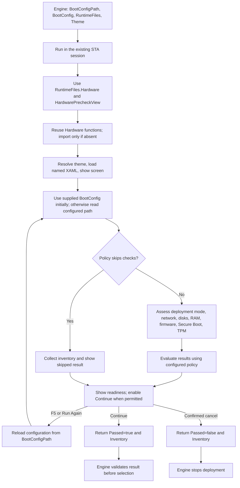

# HardwarePrecheck flow

Source: [controller](../LiteDeploy.UI.HardwarePrecheck.ps1) and
[view](../LiteDeploy.UI.HardwarePrecheck.xaml).
Published location: `Engine\Scripts\Runtime\UI`.

Standalone use must start in Windows PowerShell 5.1 with `-STA` and preload Environment
with the correct mode when RuntimeFiles is omitted. The controller retains a legacy non-STA
relaunch path, but that child does not preserve the in-memory Environment or RuntimeFiles;
do not rely on it for this configuration. Engine enforces STA before launching screens.

An empty result is not a successful precheck. Engine requires an explicit boolean Passed.
Engine's SkipPreCheck bypasses the whole screen; the screen's policy bypass still gathers
inventory. F5 is an explicit configuration refresh, not component-path discovery.

This is the code's execution flow, not proof of WPF support in a standard WinPE image.
