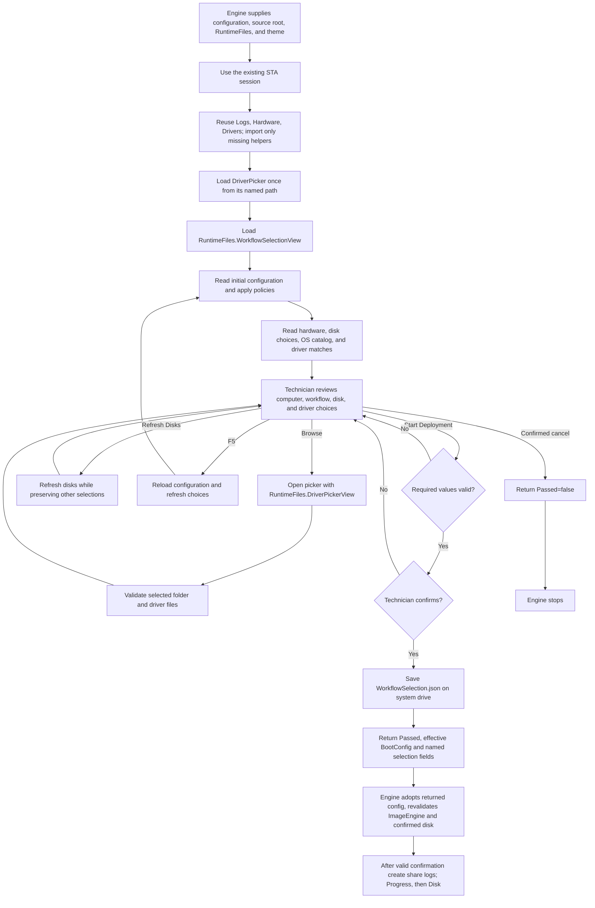

# WorkflowSelection and DriverPicker flow

Source: [controller](../LiteDeploy.UI.WorkflowSelection.ps1),
[view](../LiteDeploy.UI.WorkflowSelection.xaml), and
[picker](../LiteDeploy.UI.WorkflowSelectionDriverPicker.ps1).
Published location: `Engine\Scripts\Runtime\UI`.

Returned fields include ComputerName, WorkflowName, WorkflowTag, TargetDiskIndex,
DriverFolderPath, DeploymentUid, and SelectionJsonPath. The JSON location is based on
the system drive, typically `X:\WorkflowSelection.json` in WinPE.

Driver selection records the chosen source. It does not establish that drivers were installed.
The picker validates folders and looks for driver files before returning a path. It is loaded
once per screen; Browse does not repeatedly import it. Reopen the screen to load edited code.

Standalone use requires an STA session and preloaded Environment when RuntimeFiles is omitted.
The legacy non-STA relaunch does not preserve the in-memory Environment/file map. Use the
documented STA entry point. Actual WPF behavior still needs testing in the target boot image.

Engine assigns DeploymentUid before this screen opens. DriveSelection=false requires Disk 0; otherwise the UI supplies the selected disk. Engine adopts the returned effective configuration after confirmation. Policy/confirmed-target disagreement stops before destructive work.

