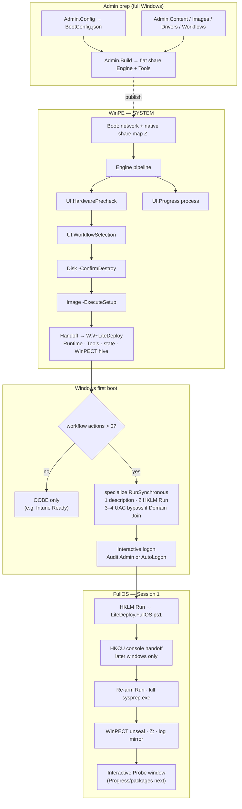

# LiteDeploy Core

<picture>
  <source media="(prefers-color-scheme: dark)" srcset="_Media/LiteDeploy-Core-Dark.png">
  <source media="(prefers-color-scheme: light)" srcset="_Media/LiteDeploy-Core-Light.png">
  
</picture>

> **This repository is for development only — not production.**  
> Full workspace for designing, testing, and lab-validating LiteDeploy. Expect breaking changes and unfinished pieces (package orchestration, real FullOS Progress). Lab / disposable-VM use only.

**Windows bare-metal imaging engine (under development)** — WinPE → install → interactive FullOS resume — plain PowerShell 5.1 components. `Admin.Build` flattens scripts into a **lab** DeploymentShare for imaging tests. A future shipping product tree is separate; **this Core repo is not that**.

| | |
| :--- | :--- |
| **Status** | **Development only — not production** |
| **Host** | Windows PowerShell 5.1 (`powershell.exe`), STA for Engine / UI |
| **Boot modes** | Network (SMB → `Z:`) and Media (USB → `<drive>:\~LiteDeploy`) |
| **Imaging** | `setup.exe` or `dism.exe` |
| **FullOS resume** | `HKLM\...\Run\LiteDeployFullOS` (not Task Scheduler / SetupComplete) |
| **Smoke suite** | [`_Tests\`](_Tests/README.md) — **155 / 155** |
| **Docs map** | [`_Docs/README.md`](_Docs/README.md) |

---

## What this project is

LiteDeploy Core is a **componentized imaging stack**, not a Task Sequence host and not an MDT fork. Each Runtime/Admin script owns one job (Boot, Disk, Image, FullOS, …). Engine orchestrates WinPE; FullOS continues after first interactive logon when the workflow has post-install **actions**.

It solves the hard handoff problems wiring usually gets wrong:

- **Credentials** never appear on `net use` command lines — native `New-SmbMapping` / `New-PSDrive` + in-memory [WinPECT](https://github.com/cmartinezone/WinPECT) seal/unseal
- **Paths** come from Environment (Development vs Production) — consumers do not invent sibling `DeploymentShare` trees
- **Unattend** is template + placeholders (`Standard` / `DomainJoin` / `IntuneReady`), with Specialize `RunSynchronous` orders owned by Image
- **State/logs** survive reboot via DeploymentState + triple mirror (RAM / share / OS volume)

**Not in scope yet (planned):** automatic package orchestration after FullOS, DeployVault as a share vault tool, cloud/Azure blob pull. See [`_Docs/planning/`](_Docs/planning/).

---

## End-to-end flow



Detailed sequence, privilege model, and reboot survival: [Architecture diagrams](_Docs/architecture/LITEDEPLOY_DEPLOYMENT_DIAGRAM.md).

---

## Mental model

| Layer | Owns | Does not own |
| :--- | :--- | :--- |
| **Boot** | WinPE entry, share connect, BootObject, launch Engine | Disk wipe, imaging |
| **Engine** | WinPE pipeline order, required component names, handoff | Domain catalog parsing (Workflow), UI chrome |
| **Environment** | Dev vs Prod path map, content resolution | Guessing missing files / creating layout trees |
| **Workflow + UI.Selection** | Catalog / selection contract. Row title is `editionName`; `(version)` is added only when that name does not already contain it | Imaging |
| **Disk / Drivers / Image** | Destructive OS work behind explicit switches | FullOS package loop |
| **FullOS** | Post-boot Session 1 resume, console handoff, secrets, Z:, Run re-arm | WinPE UI |
| **Admin.*** | Share authoring & publish | Runtime pipeline |
| **`_Tests` / `_Templates`** | Smoke suite & authoring contract | Not published to the share |

1. PowerShell **5.1** + `Set-StrictMode -Version 2.0` + WinPE constraints  
2. One responsibility per component  
3. Disk/Image read-only unless `-ConfirmDestroy` / `-ExecuteSetup`  
4. Secrets in memory / WinPECT only  
5. Edit **numbered** sources only (flat mirrors gitignored)

---

## Quick start

```powershell
# Smoke (optional published Runtime)
powershell.exe -NoProfile -STA -ExecutionPolicy Bypass `
  -File '.\_Tests\Test-LiteDeployArchitectureV2.ps1' `
  -PublishedRuntimeRoot 'C:\DeploymentShare\Engine\Scripts\Runtime'

.\_Templates\Get-LiteDeployComponentInventory.ps1 | Format-Table -AutoSize

.\Engine\Scripts\Admin\000-Build\LiteDeploy.Admin.Build.ps1 `
  -DeploymentShare 'C:\DeploymentShare'
```

Lab checklist: [Project status](_Docs/architecture/LITEDEPLOY_PROJECT_STATUS.md).

---

## Folder structure

### This repo

```text
LiteDeploy Core/
├── _Media/                  # brand art (master + GitHub light/dark README)
├── Engine/Scripts/          # numbered Admin + Runtime (+ 110-UI) — edit here
├── Engine/Tools/            # WinPECT, etc. → published to share Tools\
├── DeploymentShare/         # lab skeleton (flat Engine after Build)
├── _Templates/              # component blueprint + inventory
├── _Tests/                  # architecture smoke suite
├── _Docs/
└── _Experiments/            # local prototypes / reference (gitignored)
```

### WinPE bootstrap (ramdisk)

Minimal set inside `boot.wim` — not the full content tree:

```text
X:\~LiteDeploy\
├── Boot\LiteDeploy.Boot.ps1
├── Runtime\                 # Environment, Logs, Hardware
└── Config\BootConfig.json
```

### Deployment source (Network or Media — same tree)

Reference skeleton in this repo: [`DeploymentShare\`](DeploymentShare/). Only the **root** changes by mode:

| Mode | Root | BootConfig |
| :--- | :--- | :--- |
| **Network** | UNC share mapped to `Z:\` | `Type=Network` + `NetworkPath` |
| **Media** | `<USB>:\~LiteDeploy` (or `LocalRootName`) | `Type=Media` |

```text
<root>\                                 # e.g. \\Server\Share$ → Z:\   or   E:\~LiteDeploy
├── Config\
│   └── BootConfig.json
├── Content\
│   ├── BootMedia\
│   │   ├── ISO\
│   │   └── WIM\
│   ├── Drivers\                        # LocalCatalog.json, ComputerModels.csv, packs
│   ├── OperatingSystems\               # catalog.json + media
│   ├── Packages\
│   │   ├── Apps\
│   │   └── System\                     # e.g. autopilot-enroll, domain-join, …
│   ├── Temp\
│   └── Unattend\                       # Standard.xml, DomainJoin.xml, IntuneReady.xml
├── Engine\
│   ├── Scripts\
│   │   ├── Runtime\                    # flat LiteDeploy.*.ps1 + UI\
│   │   │                               # Engine, DeploymentEngine alias, FullOS, …
│   │   └── Admin\                      # flat Admin.*.ps1 + UI\
│   └── Tools\
│       └── WinPECT\
├── WorkFlows\                          # *.json
└── WorkLogs\
    ├── Admin\
    └── Deployments\                    # <UID>\ mirrors at runtime
```

Engine: `<root>\Engine\Scripts\Runtime\LiteDeploy.Engine.ps1`.  
More: [WinPE bootstrap](_Docs/guides/WINPE_BOOTSTRAP.md), [DeploymentShare README](DeploymentShare/README.md).

---

## Live execution chain

### 1. WinPE (SYSTEM)

```text
startnet → Boot → Engine -BootObject
  → HardwarePrecheck → WorkflowSelection → Progress
  → Disk -ConfirmDestroy → Image -ExecuteSetup
  → stage Runtime/Tools/state on W:\~LiteDeploy + WinPECT seal → reboot
```

### 2. FullOS (Session 1, when `actions.Count > 0`)

```text
specialize: Order 1 description · Order 2 HKLM Run · Orders 3–4 UAC (Domain Join only)
logon (Audit Admin | AutoLogon) → FullOS.ps1
  → HKCU console handoff (consoles started afterward) · kill sysprep.exe · re-arm Run · WinPECT · Z: · probe · Packages (planned)
  → clear Run · restore EnableLUA if bypassed
```

Native PowerShell share connect only. No SetupComplete / `auditUser` / Task Scheduler for this path.

---

## Component inventory (v2)

### Runtime

| Component | Dev folder | Published file | Role |
| :--- | :--- | :--- | :--- |
| Boot | `000-Boot` | `LiteDeploy.Boot.ps1` | startnet parent; share connect; launch Engine |
| Logs | `010-Logs` | `LiteDeploy.Logs.ps1` | CMTrace + console; mirrors |
| Environment | `020-Environment` | `LiteDeploy.Environment.ps1` | Named paths, mode, theme helpers |
| Hardware | `030-Hardware` | `LiteDeploy.Hardware.ps1` | Inventory / readiness |
| State | `040-State` | `LiteDeploy.State.ps1` | DeploymentState.json + RAM map |
| Workflow | `050-Workflow` | `LiteDeploy.Workflow.ps1` | Catalog / selection domain; edition title appends version only when the name omits it |
| Disk | `060-Disk` | `LiteDeploy.Disk.ps1` | Wipe / partition / format |
| Drivers | `070-Drivers` | `LiteDeploy.Drivers.ps1` | Catalog/hardware match (extract/stage stubs — not full apply yet) |
| Image | `080-Image` | `LiteDeploy.Image.ps1` | DISM/Setup, unattend, bcdboot, drivers |
| Packages | `090-Packages` | `LiteDeploy.Packages.ps1` | Package helpers (FullOS sequencing planned) |
| Engine | `100-Engine` | `LiteDeploy.Engine.ps1` | WinPE orchestrator |
| FullOS | `100-Engine` | `LiteDeploy.FullOS.ps1` | Post-boot Session 1 resume; HKCU console handoff on load |
| UI.* | `110-UI\...` | `Runtime\UI\LiteDeploy.UI.*` | Precheck, Selection, Progress, Theme, HostShell |

### Admin

| Component | Dev folder | Published file |
| :--- | :--- | :--- |
| Admin.Build | `000-Build` | `LiteDeploy.Admin.Build.ps1` |
| Admin.Content | `010-Content` | `LiteDeploy.Admin.Content.ps1` |
| Admin.Images | `020-Images` | `LiteDeploy.Admin.Images.ps1` |
| Admin.Drivers | `030-Drivers` | `LiteDeploy.Admin.Drivers.ps1` |
| Admin.Packages | `040-Packages` | `LiteDeploy.Admin.Packages.ps1` |
| Admin.Workflows | `050-Workflows` | `LiteDeploy.Admin.Workflows.ps1` |
| Admin.Config | `060-Config` | `LiteDeploy.Admin.Config.ps1` |
| Admin.Validation | `070-Validation` | `LiteDeploy.Admin.Validation.ps1` |
| Admin.Utilities | `080-Utilities` | `LiteDeploy.Admin.Utilities.ps1` |
| Admin UI | `090-UI` | `Admin\UI\LiteDeploy.Admin.UI.*` |

Contracts: [Component guide](_Docs/COMPONENT_GUIDE.md).

---

## Related repositories

| Repository | Role |
| :--- | :--- |
| [WinPEBuilder](https://github.com/cmartinezone/WinPEBuilder) | WinPE ISO / Boot.wim |
| [WinPECT](https://github.com/cmartinezone/WinPECT) | WinPE → FullOS credential transfer |
| [DeployVault](https://github.com/cmartinezone/DeployVault) | Future optional credential vault (not incorporated) |

---

## Documentation

| Doc | Use when |
| :--- | :--- |
| [_Docs map](_Docs/README.md) | Finding anything |
| [Project status](_Docs/architecture/LITEDEPLOY_PROJECT_STATUS.md) | What works vs gaps |
| [Architecture diagrams](_Docs/architecture/LITEDEPLOY_DEPLOYMENT_DIAGRAM.md) | E2E sequence & privilege |
| [Engine reading guide](_Docs/guides/ENGINE_READING_GUIDE.md) | Variables, imports, `-ValidateOnly` |
| [WinPE bootstrap](_Docs/guides/WINPE_BOOTSTRAP.md) | startnet / bootstrap payload |
| [Maintenance](_Docs/guides/MAINTENANCE.md) | Smoke tests, publish, release checks |
| [Credentials / WinPECT](_Docs/integrations/Credentials/README.md) | Secret handoff |
| [LOCAL_TODO](_Docs/LOCAL_TODO.md) | Active roadmap |
| [Package orchestrator plan](_Docs/planning/PACKAGE_ORCHESTRATOR_PLAN.md) | Planned FullOS packages |
| [Engine Scripts README](Engine/Scripts/README.md) | Dev folder map |
| [Deployment Share README](DeploymentShare/README.md) | Published share layout |
| [Smoke tests](_Tests/README.md) / [Templates](_Templates/README.md) | Repo tooling |

Keep changes small: one responsibility, explicit inputs, useful errors.
