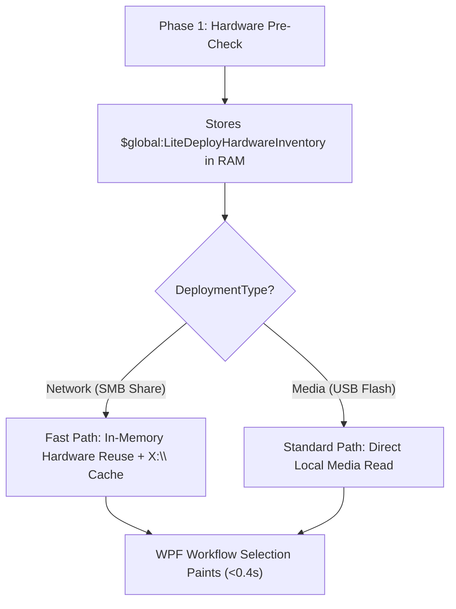

# Fast Transition Specification & Rollback Plan (Network Deployments)

**Document:** `FAST_TRANSITION_NETWORK_SPECIFICATION.md`  
**Target:** WinPE Network Deployments (`DeploymentType = "Network"`)  
**Scope:** Sub-second (<0.4s) transition from Hardware Pre-Check to Workflow Selection via In-Memory Snapshot & RAM Catalog Caching.  
**Safety:** Media/USB deployments (`DeploymentType = "Media"`) remain on standard direct disk reads. Zero breaking changes to existing parameter contracts.

---

## 1. Executive Summary

During network deployments over SMB (`Z:\`), cold WMI hardware probes and small JSON reads over the network cause a **~7.5 second pause** between Hardware Pre-Check and Workflow Selection.

This specification outlines a surgical **~45-line optimization** that:
1. Reuses the in-memory hardware snapshot collected in Phase 1 (`HardwarePreCheck`).
2. Enables a fast read-through RAM cache (`X:\~LiteDeploy\Cache\`) **exclusively for Network deployments**.
3. Retains standard direct reads for USB Media deployments (`DeploymentType = "Media"`).
4. Keeps all existing script parameter contracts 100% backward-compatible.

---

## 2. Architecture & Condition Matrix



| Deployment Mode | In-Memory Hardware Reuse | RAM Catalog Caching (`X:\`) | Behavior on `F5` / Refresh |
| :--- | :---: | :---: | :--- |
| **Network (Default)** | **Enabled** (Instant) | **Disabled** (`-CacheOnRAM = $false`) | Direct SMB network read from `Z:\WorkFlows\` |
| **Network (`-CacheOnRAM`)** | **Enabled** (Instant) | **Enabled** (<100 KB in RAM) | Re-queries network share and refreshes RAM cache |
| **Media (`D:\~LiteDeploy`)** | Optional Fallback | **Disabled** (Direct local reads) | Standard direct local disk read |

---

## 3. Detailed File-by-File Changes

### File 1: `Engine\Scripts\Runtime\070-Drivers\LiteDeploy.Drivers.ps1`
* **Function:** `Get-SystemDriverDetection`
* **Changes:** Add optional `[psobject]$HardwareInventory = $null` parameter. When present, read manufacturer, model, and SKU from the object instead of re-querying WMI.
* **Code:**
```powershell
function Get-SystemDriverDetection {
    param(
        [Parameter(Mandatory = $true)]
        [string]$ShareRoot,
        [Parameter(Mandatory = $false)]
        [psobject]$HardwareInventory = $null
    )
    $vendor = if ($HardwareInventory -and $HardwareInventory.PSObject.Properties['Vendor']) { $HardwareInventory.Vendor } else { Get-HardwareVendor }
    $model  = if ($HardwareInventory -and $HardwareInventory.PSObject.Properties['Model']) { $HardwareInventory.Model } else { Get-HardwareModel }
    $sku    = if ($HardwareInventory -and $HardwareInventory.PSObject.Properties['Sku']) { $HardwareInventory.Sku } else { Get-HardwareSKU }
    # ... rest of matching logic remains 100% unchanged
```

---

### File 2: `Engine\Scripts\Runtime\050-Workflow\LiteDeploy.Workflow.ps1`
* **Function:** `Get-LiteDeployWorkflows`
* **Changes:** Added `[switch]$CacheOnRAM` parameter (default: `$false`).
  - **When `$CacheOnRAM` is `$false` (default)**: Directly scans and loads all workflow JSON definitions from `<ShareRoot>\WorkFlows\*.json` over SMB with zero RAM caching.
  - **When `-CacheOnRAM` is passed (`$true`)**: Checks `X:\~LiteDeploy\Cache\WorkFlows\` before reading over SMB; reads instantly from RAM (<1ms) and populates the cache on first read.
* **Code:**
```powershell
param(
    [string]$ShareRoot = "",
    [string]$OsId = "",
    [string]$EditionId = "",
    [switch]$IncludeDisabled,
    [switch]$CacheOnRAM
)

# Fast RAM cache check for WinPE Network mode (Active only when -CacheOnRAM is explicitly enabled)
$ramCacheDir = "X:\~LiteDeploy\Cache\WorkFlows"
$effectiveWorkflowDir = $workflowDir
$isWinPE = (Test-Path -LiteralPath "X:\Windows\System32" -PathType Container)
if ($CacheOnRAM -and $isWinPE -and (Test-Path -LiteralPath $ramCacheDir -PathType Container)) {
    $cachedFiles = @(Get-ChildItem -LiteralPath $ramCacheDir -Filter "*.json" -File -ErrorAction SilentlyContinue)
    if ($cachedFiles.Count -gt 0) {
        $effectiveWorkflowDir = $ramCacheDir
    }
}
```

---

### File 3: `Engine\Scripts\Runtime\110-UI\WorkflowSelection\LiteDeploy.UI.WorkflowSelection.ps1`
* **Architecture:** Uses standard direct Hardware module calls (`Get-HardwareVendor`, `Get-HardwareModel`, `Get-HardwareFirmwareType`, etc.) for device identity and firmware card rendering.
* **Driver Detection:** Calls `Get-SystemDriverDetection -ShareRoot $script:DeploymentSharePath` immediately on startup with fast sub-millisecond SMB archive validation (<1ms size check), ensuring instant window rendering without deferred timer latency.

---

---

## 4. UI Title Affordances & Diagnostic Logging

### Window Title Affordance
Both UI phases append `[F5: Refresh]` to the window title bar to guide technicians in field environments:
- **Hardware PreCheck:** `LiteDeploy Hardware PreCheck v2.0.0 [F5: Refresh]`
- **Workflow Selection:** `LiteDeploy Workflow Selection v2.0.0 [F5: Refresh]`

### Diagnostic Logging
- **Hardware Snapshot Reuse:**
  `[INFO] [Drivers] Fast Transition: Reused in-memory hardware inventory for Dell Inc. Latitude 7450 (0 ms WMI overhead).`
- **F5 Manual Refresh:**
  `[INFO] [HardwarePreCheck] Technician triggered manual refresh (F5). Rerunning Hardware PreCheck...`
  `[INFO] [WorkflowSelection] Technician triggered manual refresh (F5). Reloading configuration, disks, and catalogs...`

---

## 5. Parameter & Contract Safety Analysis

| Parameter / Contract | Old State | New State | Breaking? | Notes |
| :--- | :--- | :--- | :---: | :--- |
| `Get-SystemDriverDetection -ShareRoot` | Mandatory | Mandatory | **No** | Core signature unchanged. |
| `Get-SystemDriverDetection -HardwareInventory` | N/A | Optional (`$null`) | **No** | Existing callers can omit it without error. |
| `LiteDeploy.UI.WorkflowSelection.ps1` params | Mandatory paths | Mandatory paths | **No** | New `-HardwareInventory` is optional. |
| Output contract (`WorkflowSelection.json`) | Standard object | Standard object | **No** | Output properties are 100% identical. |

---

## 5. Rollback Plan

If any regression or unexpected behavior occurs, rollback can be executed in under 2 minutes:

### Rollback Step 1: Remove Optional Parameter from Engine
In `Engine\Scripts\Runtime\100-Engine\LiteDeploy.Engine.ps1` (Phase 2):
```diff
-$workflowResult = & $workflowScript ... -HardwareInventory $global:LiteDeployHardwareInventory ...
+$workflowResult = & $workflowScript ... -Theme $uiTheme
```
* Removing this single parameter immediately restores cold WMI query behavior for all deployments.

### Rollback Step 2: Synchronize Share
Run the build synchronizer to update the deployment share:
```powershell
pwsh -ExecutionPolicy Bypass -File "Engine\Scripts\Admin\000-Build\LiteDeploy.Admin.Build.ps1" -Clean
```

### Rollback Step 3: Verify Test Suite
Run the architecture test suite:
```powershell
pwsh -ExecutionPolicy Bypass -File "_Tests\Test-LiteDeployArchitectureV2.ps1"
```
Ensure all 159 tests pass cleanly.
