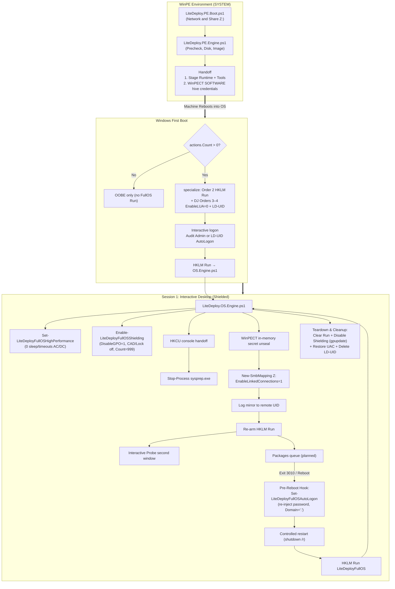
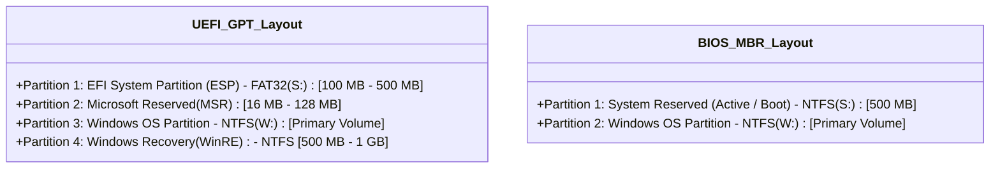
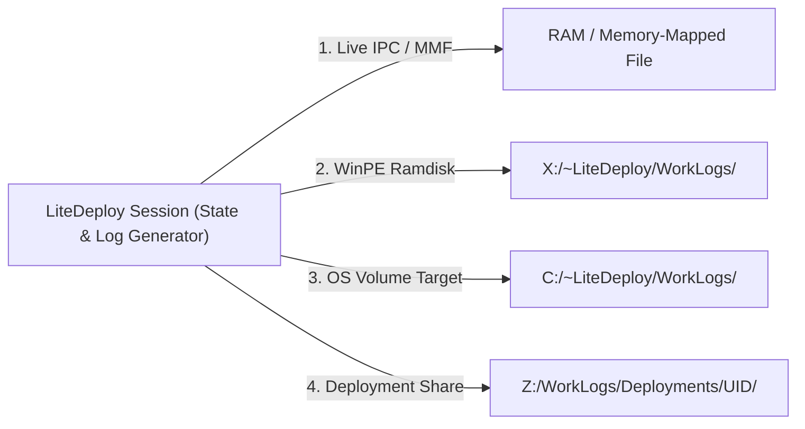
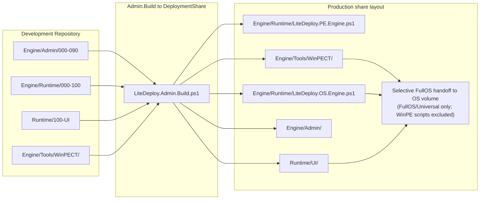

# LiteDeploy Architecture and Execution Diagrams

Updated 2026-11-10. LiteDeploy Core v2 Architecture:
- **WinPE Engine** ([`010-Engine/LiteDeploy.PE.Engine.ps1`](../../Engine/Runtime/010-Engine/LiteDeploy.PE.Engine.ps1))
- **FullOS Engine** ([`010-Engine/LiteDeploy.OS.Engine.ps1`](../../Engine/Runtime/010-Engine/LiteDeploy.OS.Engine.ps1))
- **Session & Logging** ([`030-Session/LiteDeploy.Session.ps1`](../../Engine/Runtime/030-Session/LiteDeploy.Session.ps1))
- **Actions gating** — `WorkflowTag.Actions`; FullOS Run (+ Audit reseal / Domain Join UAC bypass) only when `actions.Count > 0` (e.g. Intune Ready with 0 actions → OOBE only, no Run)
- **First FullOS entry** — unattend **specialize** stages `HKLM\...\Run\LiteDeployFullOS` when actions > 0 (short `powershell.exe -File` / `REG_EXPAND_SZ`; no `auditUser`); keep **HKLM Run** as primary resume (not Startup / Task Scheduler)
- **Logon models** — Standard = Audit Admin (elevated); Domain Join = AutoLogon ephemeral service account `LD-<UID>` (`<!--LocalServiceAccount-->` / `<!--AutoLogonServiceAccount-->`) + temporary `EnableLUA=0` / `UacBypassed` when no `<!--AuditMode-->` and actions > 0; FullOS cleanup restores `EnableLUA=1`
- **Direct Interactive Desktop Execution** (Session 1):
  - Universal High Performance power plan (`Set-LiteDeployFullOSHighPerformance`: AC/DC sleep and timeouts set to 0)
  - FullOS Environment Shielding (`Enable-LiteDeployFullOSShielding`: `DisableGPO=1`, legal notices blanked, `DisableCAD=1`, `NoLockScreen=1`, `AutoLogonCount=999`)
  - In-memory WinPECT secret unsealing (`Read-WPCTCredentialTransfer` targeting `LiteDeploy\CredentialTransfer`)
  - Native PowerShell `New-SmbMapping` + `New-PSDrive`; `EnableLinkedConnections = 1` so `Z:` is Explorer-visible
  - Log mirroring (`WorkLogs\Deployments\<UID>`)
  - On load, `HKCU\Console\%%Startup` `DelegationConsole` and `DelegationTerminal` (`{B23D10C0-E52E-411E-9D5B-C09FDF709C7D}`) so consoles started afterward hand off to Windows Terminal. The window that already launched FullOS is unchanged. A registry failure does not stop resume
  - Kill `sysprep.exe` process; leave stock Setup `CmdLine` (sysprep) intact
  - Live console monitor integrated directly in FullOS; real Progress / packages orchestration next
- **Reboot Survival & AutoLogon Shielding** — HKLM Run re-armed via `Set-LiteDeployFullOSRunKey`; Pre-Reboot Hook (`Set-LiteDeployFullOSAutoLogon`: restore `DefaultPassword`, `DefaultUserName`, `DefaultDomainName='.'`, `AutoLogonCount=999`) guarantees unattended resume across mid-deploy reboots (3010); LiteDeploy_* scheduled tasks gated off / cleaned
- **Teardown & Cleanup** — `Disable-LiteDeployFullOSShielding` (unfreezes GPO, restores original policies, triggers `gpupdate /force`), `Restore-LiteDeployFullOSUacBypass`, and `Clear-LiteDeployFullOSRunKey`
- **MDT reference** — stock MDT uses Startup `LiteTouch.lnk` / `RunOnce` / `FirstLogonCommands`→`LTIBootstrap`, not Task Scheduler; LiteDeploy stays on HKLM Run
- **Execution Model** — Operates 100% in the interactive user desktop session (Session 1). Headless Session 0 SYSTEM daemon has been retired from the roadmap.

---

## 0. End-to-End Imaging Process (overview image)

*(Removed — prior `litedeploy-e2e-imaging-process.jpg` was incomplete / outdated. Re-add only after a regenerated overview that matches the live HKLM Run + actions-gating baseline.)*

---

## 1. End-to-End Execution Sequence Diagram

```mermaid
sequenceDiagram
    autonumber
    participant PE as "WinPE / Engine"
    participant OSVol as "OS volume"
    participant WSetup as "Windows Setup"
    participant Admin as "Session 1 / FullOS"
    participant Share as "DeploymentShare Z:"

    Note over PE,OSVol: 1. WinPE imaging and staging
    PE->>OSVol: Apply OS image (WIM / Setup.exe)
    PE->>OSVol: Stage drivers under ~LiteDeploy/Content/Drivers
    PE->>OSVol: Stage unattend.xml (specialize Run + Audit/AutoLogon)

    alt No workflow actions (actions == 0, e.g. Intune Ready)
        PE->>Share: Mirror final state & logs to DeploymentShare
        PE->>OSVol: Purge ~LiteDeploy from OS volume (100% clean disk)
        PE->>WSetup: Reboot directly into OOBE / Autopilot
        WSetup->>WSetup: Specialize skips FullOS Run - direct to OOBE
    else Workflow has actions (actions > 0)
        PE->>OSVol: Selective FullOS staging (FullOS/Universal only; WinPE excluded)
        opt Audit Mode workflow
            PE->>OSVol: Stage Unattend-OOBE.xml to Content/
        end
        PE->>OSVol: WinPECT seals credentials in SOFTWARE hive
        PE->>OSVol: Save DeploymentState.json
        PE->>WSetup: Reboot into Windows

        Note over WSetup,Admin: 2. Specialize arms Run - first interactive FullOS
        WSetup->>WSetup: Order 1 description - Order 2 reg add HKLM Run
        opt Domain Join without AuditMode marker
            WSetup->>WSetup: Order 3 EnableLUA=0 - Order 4 UacBypassed marker
            WSetup->>WSetup: Inject ephemeral LD-<UID> + AutoLogon (Count=999)
        end
        WSetup->>Admin: Interactive logon (Audit Admin or LD-<UID> AutoLogon)
        WSetup->>Admin: HKLM Run launches LiteDeploy.OS.Engine.ps1

        Note over Admin,Share: 3. Interactive FullOS Session 1 (Shielded)
        Admin->>Admin: HKCU console handoff for later windows
        Admin->>Admin: Set-LiteDeployFullOSHighPerformance (Timeouts=0 AC/DC)
        Admin->>OSVol: Enable-LiteDeployFullOSShielding (DisableGPO=1, blank notices, DisableCAD, NoLockScreen)
        Admin->>Admin: Kill sysprep.exe process
        Admin->>OSVol: Re-arm HKLM Run LiteDeployFullOS
        Admin->>OSVol: Read DeploymentState.json (FullOS / Phase 5)
        Admin->>OSVol: WinPECT unseals secrets in RAM
        Admin->>Share: New-SmbMapping Z: with EnableLinkedConnections
        Admin->>Share: Mirror WorkLogs to share WorkLogs/Deployments/UID
        Admin->>Admin: Start Interactive Probe second window
        Note over Admin,Share: Packages orchestration planned - not fully wired

        opt Mid-deploy reboot (Exit Code 3010)
            Admin->>OSVol: Set-LiteDeployFullOSRunKey (re-arm HKLM Run)
            Admin->>OSVol: Set-LiteDeployFullOSAutoLogon (restore DefaultPassword, DefaultDomainName='.')
            Admin->>WSetup: Controlled restart (shutdown.exe /r /t 5)
            Note over WSetup,Admin: 4. Reboot survival via HKLM Run & Shielded AutoLogon
            WSetup->>Admin: Autologon / interactive logon
            WSetup->>Admin: HKLM Run launches LiteDeploy.OS.Engine.ps1
            Admin->>OSVol: Increment ResumeCount and continue
        end

        Note over Admin,OSVol: 5. Teardown & Finalization
        Admin->>OSVol: Clear-LiteDeployFullOSRunKey
        Admin->>OSVol: Disable-LiteDeployFullOSShielding (unfreeze GPO, restore notices/CAD, gpupdate /force)
        Admin->>OSVol: Restore-LiteDeployFullOSUacBypass (restore EnableLUA=1)
        opt Ephemeral account cleanup
            Admin->>OSVol: Delete LD-<UID> & purge user profile
        end
        opt Audit Mode with actions
            Admin->>OSVol: Invoke-LiteDeploySysprepReseal (sysprep /oobe /reboot /unattend:Unattend-OOBE.xml)
        end
        Admin->>OSVol: Save DeploymentState.json Status Completed
        Admin->>Share: Final log mirror
    end
```

---

## 2. Execution & Privilege Architecture



---

## 3. WinPE Runtime Pipeline Architecture

```mermaid
flowchart TD
    subgraph BootPhase["Phase 0: WinPE Bootstrap"]
        StartNet["startnet.cmd"] --> BootInit["LiteDeploy.PE.Boot.ps1"]
        BootInit --> NetConn["Network / DHCP / SMB Connect"]
        NetConn --> MountShare["Mount Deployment Share (Z:)"]
        MountShare --> HandEngine["LiteDeploy.PE.Engine.ps1"]
    end

    subgraph EnginePhase["Phases 1-4: Precheck through Image"]
        HandEngine --> Precheck["UI.HardwarePrecheck"]
        Precheck --> Selection["UI.WorkflowSelection"]
        Selection --> Progress["UI.Progress host"]
        Progress --> Disk["LiteDeploy.Disk -ConfirmDestroy"]
        Disk --> Image["LiteDeploy.Image -ExecuteSetup"]
    end

    subgraph HandoffPhase["Phase 5: Handoff & Staging"]
        Image --> ActionsGate{"actions > 0?"}
        ActionsGate -->|No (Zero-Action)| CleanPurge["Zero-Action Purge:<br/>Sync Logs to Share Z: & Delete ~LiteDeploy from OS Volume"]
        CleanPurge --> RebootDirect["Reboot directly to OOBE / Autopilot<br/>(100% clean disk)"]
        ActionsGate -->|Yes| StagePayload["Stage Selective FullOS Payload<br/>(FullOS/Universal only; WinPE excluded)"]
        StagePayload --> AuditReseal{"Audit Mode?"}
        AuditReseal -->|Yes| StageOOBE["Stage Unattend-OOBE.xml to Content/"]
        AuditReseal -->|No| WinPECT["WinPECT export (RAM secrets + SOFTWARE hive)"]
        StageOOBE --> WinPECT
        WinPECT --> HandoffLogs["Logs and State Mirror to W:/~LiteDeploy"]
        HandoffLogs --> StopProgress["Stop-LiteDeployProgressHost"]
        HandoffLogs --> RebootTarget["Reboot into installed Windows"]
    end
```

---

## 4. Component Responsibility Matrix

| Component | Execution Context | Trigger | Key Responsibilities |
| :--- | :--- | :--- | :--- |
| [`LiteDeploy.PE.Engine.ps1`](../../Engine/Runtime/010-Engine/LiteDeploy.PE.Engine.ps1) | WinPE (SYSTEM) | [`LiteDeploy.PE.Boot.ps1`](../../Engine/Runtime/000-Boot/LiteDeploy.PE.Boot.ps1) | Hardware precheck, disk wipe/partitioning, imaging, driver/unattend staging, WinPECT export, Runtime/Tools staging. |
| [`LiteDeploy.OS.Engine.ps1`](../../Engine/Runtime/010-Engine/LiteDeploy.OS.Engine.ps1) | Session 1 (interactive admin or `LD-<UID>`) | HKLM Run (specialize-staged; FullOS may re-arm) | Universal High Performance (`Set-LiteDeployFullOSHighPerformance`), FullOS Environment Shielding (`Enable-LiteDeployFullOSShielding`), HKCU console handoff, kill `sysprep.exe`, WinPECT RAM unseal, `Z:` reconnect (`EnableLinkedConnections`), log mirror, re-arm HKLM Run, live console monitor; Pre-Reboot Hook (`Set-LiteDeployFullOSAutoLogon`), Teardown (`Disable-LiteDeployFullOSShielding`, `Restore-LiteDeployFullOSUacBypass`, and `Clear-LiteDeployFullOSRunKey`). Packages planned. Scheduled tasks gated off. |
| [`LiteDeploy.Image.ps1`](../../Engine/Runtime/080-Image/LiteDeploy.Image.ps1) | WinPE | Engine Image phase | Unattend: Order 1 description; Order 2 FullOS Run when `WorkflowTag.Actions` > 0; Orders 3–4 `EnableLUA=0` + marker when Domain Join (no Audit) + actions; Audit reseal when `<!--AuditMode-->` + actions. |
| [`LiteDeploy.Session.ps1`](../../Engine/Runtime/030-Session/LiteDeploy.Session.ps1) | WinPE & FullOS | Sibling helper (Session) | Unified deployment state document, RAM memory-map IPC, CMTrace logging, UNC share resolution, and verified artifact synchronization across WinPE and FullOS. |
| **HKLM Run** | Interactive admin | specialize first arm; logon thereafter | Primary FullOS entry + mid-deploy reboot survival (`LiteDeployFullOS`). Kept for now (not MDT Startup / Task Scheduler). |
| **Setup CmdLine (sysprep)** | Windows Setup / Audit | stock Audit continue | Left intact; FullOS kills the `sysprep.exe` process instead of rewriting Setup. |

---

## 5. Disk Layout Architectures



---

## 6. Logs & State Synchronization (Quad Mirror Architecture)



---

## 7. Component Ownership & Publishing Layout



