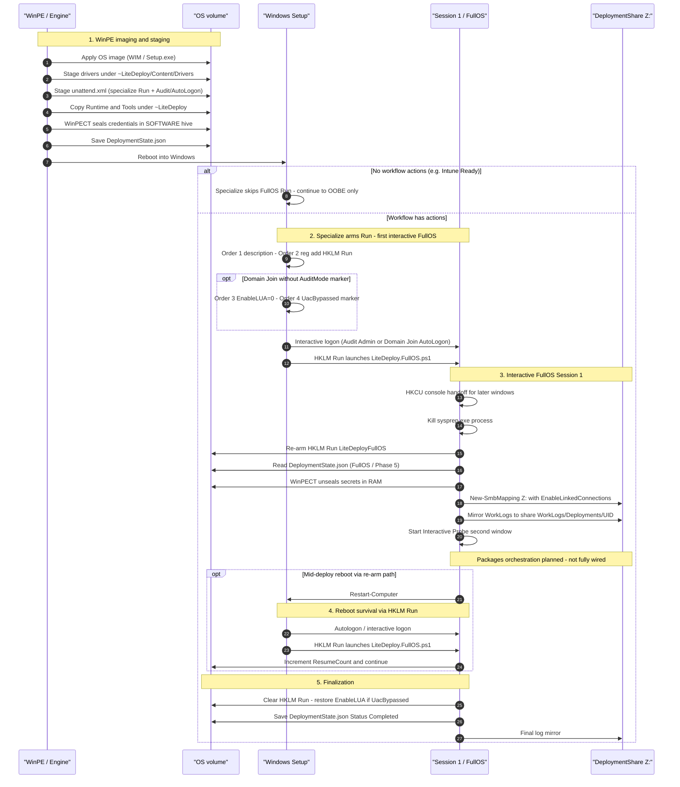
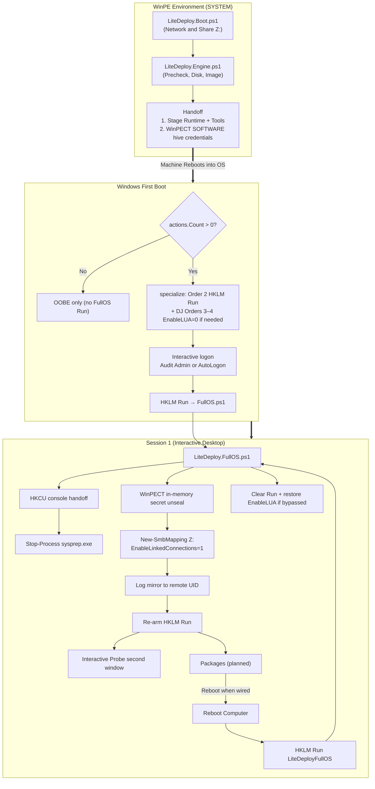
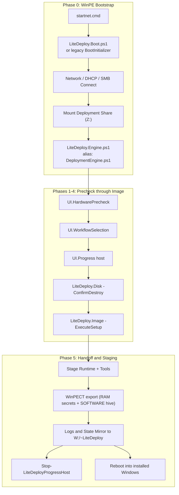
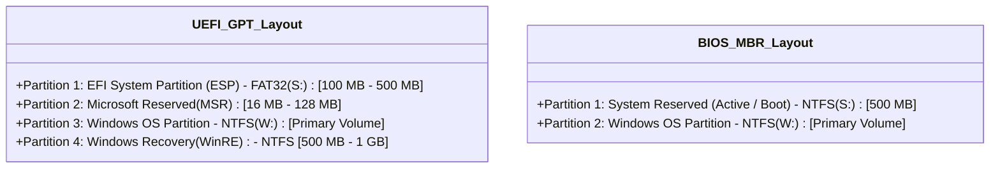
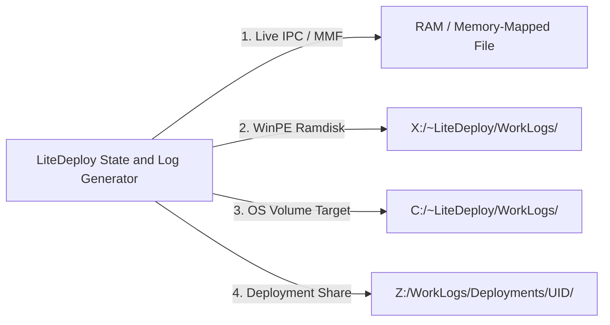
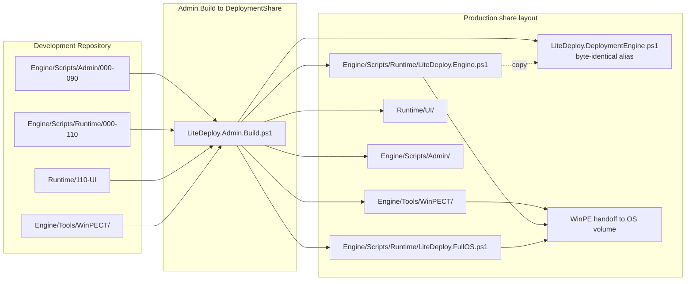

# LiteDeploy Architecture and Execution Diagrams

Updated 2026-10-13. LiteDeploy Core v2 Architecture:
- **WinPE Engine** ([`100-Engine/LiteDeploy.Engine.ps1`](../../Engine/Scripts/Runtime/100-Engine/LiteDeploy.Engine.ps1); publish alias [`DeploymentEngine.ps1`](../../DeploymentShare/Engine/Scripts/Runtime/LiteDeploy.DeploymentEngine.ps1))
- **FullOS Engine** ([`100-Engine/LiteDeploy.FullOS.ps1`](../../Engine/Scripts/Runtime/100-Engine/LiteDeploy.FullOS.ps1))
- **Actions gating** — `WorkflowTag.Actions`; FullOS Run (+ Audit reseal / Domain Join UAC bypass) only when `actions.Count > 0` (e.g. Intune Ready with 0 actions → OOBE only, no Run)
- **First FullOS entry** — unattend **specialize** stages `HKLM\...\Run\LiteDeployFullOS` when actions > 0 (short `powershell.exe -File` / `REG_EXPAND_SZ`; no `auditUser`); keep **HKLM Run** as primary resume (not Startup / Task Scheduler)
- **Logon models** — Standard = Audit Admin (elevated); Domain Join = AutoLogon local admin + temporary `EnableLUA=0` / `UacBypassed` when no `<!--AuditMode-->` and actions > 0; FullOS cleanup restores `EnableLUA=1`
- **Direct Interactive Desktop Execution** (Session 1):
  - In-memory WinPECT secret unsealing (`Read-WPCTCredentialTransfer` targeting `LiteDeploy\CredentialTransfer`)
  - Native PowerShell `New-SmbMapping` + `New-PSDrive`; `EnableLinkedConnections = 1` so `Z:` is Explorer-visible
  - Log mirroring (`WorkLogs\Deployments\<UID>`)
  - On load, `HKCU\Console\%%Startup` `DelegationConsole` and `DelegationTerminal` (`{B23D10C0-E52E-411E-9D5B-C09FDF709C7D}`) so consoles started afterward hand off to Windows Terminal. The window that already launched FullOS is unchanged. A registry failure does not stop resume
  - Kill `sysprep.exe` process; leave stock Setup `CmdLine` (sysprep) intact
  - Interactive Probe in a second independent PowerShell window (`Start-LiteDeployFullOSInteractiveProbe`); real Progress / packages still open
- **Reboot Survival** (same HKLM Run value; FullOS may re-arm; LiteDeploy_* scheduled tasks gated off / cleaned)
- **MDT reference** — stock MDT uses Startup `LiteTouch.lnk` / `RunOnce` / `FirstLogonCommands`→`LTIBootstrap`, not Task Scheduler; LiteDeploy stays on HKLM Run
- **Future Headless Exploration Roadmap** (Decoupled SYSTEM worker + IPC progress bar, detailed in [`IDEAS_FOR_IMPLEMENTATION.md`](../planning/IDEAS_FOR_IMPLEMENTATION.md) §3)

---

## 0. End-to-End Imaging Process (overview image)

*(Removed — prior `litedeploy-e2e-imaging-process.jpg` was incomplete / outdated. Re-add only after a regenerated overview that matches the live HKLM Run + actions-gating baseline.)*

---

## 1. End-to-End Execution Sequence Diagram

---

## 2. Execution & Privilege Architecture

---

## 3. WinPE Runtime Pipeline Architecture

---

## 4. Component Responsibility Matrix

| Component | Execution Context | Trigger | Key Responsibilities |
| :--- | :--- | :--- | :--- |
| [`LiteDeploy.Engine.ps1`](../../Engine/Scripts/Runtime/100-Engine/LiteDeploy.Engine.ps1) | WinPE (SYSTEM) | [`LiteDeploy.Boot.ps1`](../../Engine/Scripts/Runtime/000-Boot/LiteDeploy.Boot.ps1) | Hardware precheck, disk wipe/partitioning, imaging, driver/unattend staging, WinPECT export, Runtime/Tools staging. |
| [`LiteDeploy.FullOS.ps1`](../../Engine/Scripts/Runtime/100-Engine/LiteDeploy.FullOS.ps1) | Session 1 (interactive admin) | HKLM Run (specialize-staged; FullOS may re-arm) | On load, HKCU console handoff for later windows; state progression (Phase 5), kill sysprep.exe, WinPECT unseal, `Z:` reconnect (`EnableLinkedConnections`), log mirror, re-arm HKLM Run, Interactive Probe window; clear Run + restore UAC on finish. Packages planned. Scheduled tasks gated off. |
| [`LiteDeploy.FullOS.InteractiveProbe.ps1`](../../Engine/Scripts/Runtime/100-Engine/LiteDeploy.FullOS.InteractiveProbe.ps1) | Session 1 | `Start-Process` from FullOS | Temporary Progress dry-run in a second window; monitors state / `Z:`. |
| [`LiteDeploy.Image.ps1`](../../Engine/Scripts/Runtime/080-Image/LiteDeploy.Image.ps1) | WinPE | Engine Image phase | Unattend: Order 1 description; Order 2 FullOS Run when `WorkflowTag.Actions` > 0; Orders 3–4 `EnableLUA=0` + marker when Domain Join (no Audit) + actions; Audit reseal when `<!--AuditMode-->` + actions. |
| **HKLM Run** | Interactive admin | specialize first arm; logon thereafter | Primary FullOS entry + mid-deploy reboot survival (`LiteDeployFullOS`). Kept for now (not MDT Startup / Task Scheduler). |
| **Setup CmdLine (sysprep)** | Windows Setup / Audit | stock Audit continue | Left intact; FullOS kills the `sysprep.exe` process instead of rewriting Setup. |

---

## 5. Disk Layout Architectures

---

## 6. Logs & State Synchronization (Quad Mirror Architecture)

---

## 7. Component Ownership & Publishing Layout

