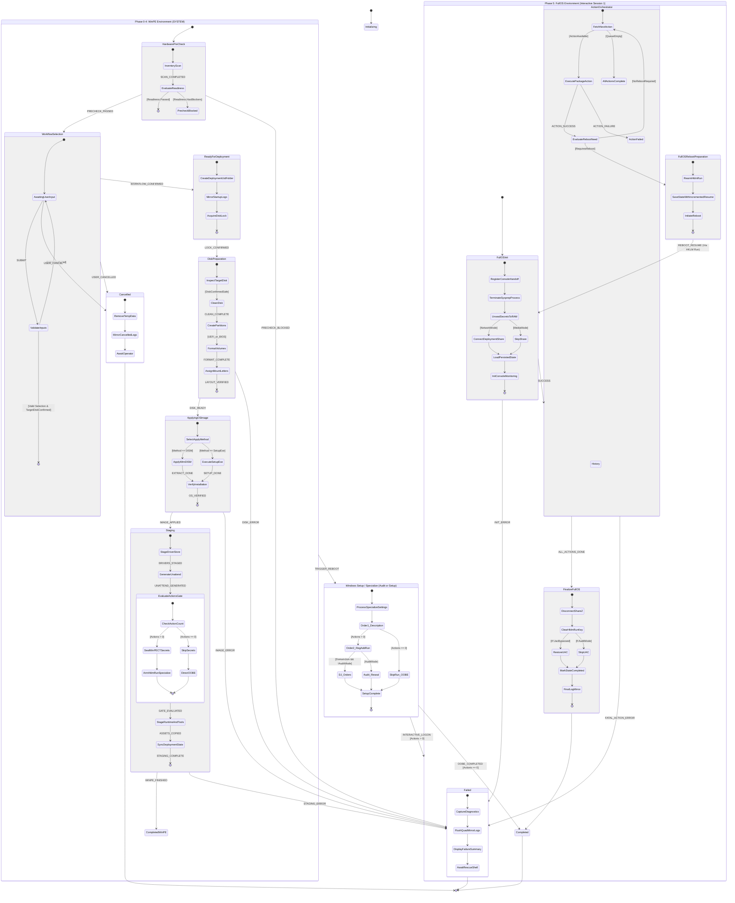
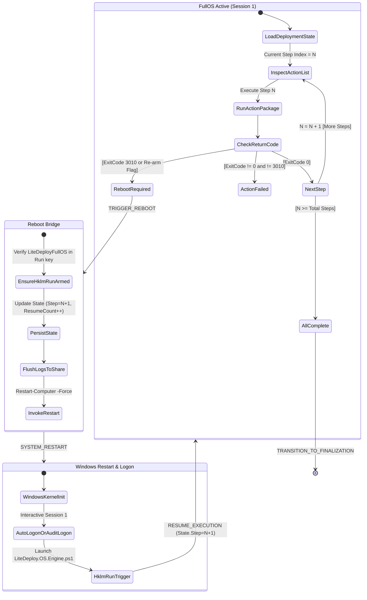

# LiteDeploy Statechart Architecture Diagrams (Proposed Alternative)

> **Document Type:** Evaluation Draft / New Version Proposal  
> **Status:** Review Only — Existing diagrams in [`LITEDEPLOY_DEPLOYMENT_DIAGRAM.md`](LITEDEPLOY_DEPLOYMENT_DIAGRAM.md) remain active and unmodified.  
> **Updated:** 2026-11-05  

---

## Executive Summary: Why Statecharts?

The current architecture documentation relies primarily on linear sequence diagrams (`sequenceDiagram`) and basic block graphs (`flowchart TD`). While clear for happy-path traces, they do not formally capture:
1. **Hierarchical Boundary Isolation:** Clear containment of WinPE (SYSTEM) vs Windows Setup (Specialize) vs FullOS (Interactive Session 1).
2. **Conditional Guards (`[guard]`):** Precise gating logic (such as `actions.Count > 0`, `AuditMode` vs `DomainJoin`, `Network` vs `Media`).
3. **Reboot Survival with History ($H$):** How state is preserved and restored across machine restarts in FullOS.
4. **Universal Failure & Cancellation Concurrency:** How any active sub-state transitions cleanly into `Failed` or `Cancelled` while enforcing log mirroring and cleanup.

This document presents a **Harel Statechart** model (`stateDiagram-v2`) for LiteDeploy Core v2.

---

## 1. End-to-End Hierarchical Statechart



---

## 2. Detailed Sub-Statecharts

### 2.1 Staging & WinPECT Secrets Handoff
This detail clarifies how credentials transition from active RAM into offline Windows without hitting plaintext disk files:

```mermaid
stateDiagram-v2
    [*] --> ReadStagingPaths: From Environment ($global:LiteDeployPaths)

    state ReadStagingPaths {
        [*] --> VerifyOfflineOsVolume: Confirm W: is mounted
        VerifyOfflineOsVolume --> CreateDirectoryStructure: W:\~LiteDeploy\...
        CreateDirectoryStructure --> [*]
    }

    ReadStagingPaths --> CopyAssets: PATHS_VERIFIED
    
    state CopyAssets {
        [*] --> CopyRuntimeScripts
        CopyRuntimeScripts --> CopyToolsAndWinPECT
        CopyToolsAndWinPECT --> StageSelectedDrivers
        StageSelectedDrivers --> [*]
    }

    CopyAssets --> CredentialSealing: ASSETS_STAGED

    state CredentialSealing {
        [*] --> CheckMode
        CheckMode --> BypassSecrets: [Media / USB Mode]
        CheckMode --> LoadOfflineSoftwareHive: [Network Mode]
        LoadOfflineSoftwareHive --> SealWPCTSecret: Write to HKLM\OFFLINE_SOFTWARE\LiteDeploy\CredentialTransfer
        SealWPCTSecret --> UnloadOfflineHive: Unload cleanly
        UnloadOfflineHive --> [*]
        BypassSecrets --> [*]
    }

    CredentialSealing --> GenerateUnattendXml: SECRETS_SEALED

    state GenerateUnattendXml {
        [*] --> CheckActionCount
        CheckActionCount --> ConfigureSpecializeRun: [actions.Count > 0]
        CheckActionCount --> ConfigureOOBEOnly: [actions.Count == 0]
        ConfigureSpecializeRun --> InjectUnattendPlaceholders
        ConfigureOOBEOnly --> InjectUnattendPlaceholders
        InjectUnattendPlaceholders --> WriteUnattendFile: W:\Windows\Panther\unattend.xml
        WriteUnattendFile --> [*]
    }

    GenerateUnattendXml --> FinalizeWinPEState: UNATTEND_STAGED

    state FinalizeWinPEState {
        [*] --> SerializeDeploymentState: Set Phase 4 Done, Next 5
        SerializeDeploymentState --> WriteQuadMirror: RAM, X:, W:, Z:
        WriteQuadMirror --> [*]
    }

    FinalizeWinPEState --> [*]: READY_FOR_REBOOT
```

---

### 2.2 FullOS Reboot Survival Loop (State Memory)
Illustrates how the machine loops between Session 1 interactive boots when software packages require intermediate reboots:



---

## 3. State Transition & Guard Matrix

| # | Current State | Trigger Event | Guard / Pre-condition | Next State | Action / Side-Effect |
|---|---|---|---|---|---|
| **T01** | `Initializing` | `BOOT_COMPLETE` | `Valid(BootConfig.json)` | `HardwarePreCheck` | Logs boot mode (Network/Media); mounts `Z:` if network |
| **T02** | `HardwarePreCheck` | `EVALUATION_DONE`| `Readiness.Passed == $true` | `WorkflowSelection` | Saves hardware inventory snapshot; launches UI |
| **T03** | `HardwarePreCheck` | `EVALUATION_DONE`| `Readiness.Passed == $false`| `Failed` | Flags hardware blockers (e.g. disk too small, TPM absent) |
| **T04** | `WorkflowSelection` | `SELECTION_SUBMIT`| `TargetDisk != $null` & `Workflow != $null` | `ReadyForDeployment` | Locks target disk; assigns `DeploymentUid` |
| **T05** | `WorkflowSelection` | `USER_CANCEL` | - | `Cancelled` | Releases share locks; sets status `Cancelled` |
| **T06** | `ReadyForDeployment`| `DISK_CONFIRMED` | Confirmation matches UI target | `DiskPreparation` | Creates UID log directory on share; mirrors startup logs |
| **T07** | `DiskPreparation` | `DISK_LAYOUT_OK` | Partitions created & validated | `ApplyingOSImage` | Updates State to `DiskPreparation` (Phase 3 complete) |
| **T08** | `DiskPreparation` | `DISK_ERROR` | Partitioning/formatting throws | `Failed` | Halts execution; records Diskpart/Storage error |
| **T09** | `ApplyingOSImage` | `IMAGE_EXTRACT_OK`| OS volume populated & bootmgr set | `Staging` | Updates State to `ApplyingOSImage` (Phase 4 complete) |
| **T10** | `Staging` | `STAGING_COMPLETE`| `WorkflowTag.Actions.Count > 0` | `SpecializePhase` | Injects HKLM Run into unattend; seals WinPECT secrets |
| **T11** | `Staging` | `STAGING_COMPLETE`| `WorkflowTag.Actions.Count == 0` | `SpecializePhase` | Leaves unattend free of FullOS Run; directs straight to OOBE |
| **T12** | `SpecializePhase` | `INTERACTIVE_LOGON`| `actions.Count > 0` | `FullOS` | Sysprep kill; WinPECT RAM unseal; log mirror attach |
| **T13** | `SpecializePhase` | `OOBE_COMPLETE` | `actions.Count == 0` | `Completed` | Deployment finishes clean at standard Windows logon |
| **T14** | `FullOS` | `PACKAGE_REBOOT` | `ExitCode in (3010)` or Package flagged | `FullOS` (loop) | Re-arms HKLM Run; increments `ResumeCount`; reboots |
| **T15** | `FullOS` | `ACTIONS_COMPLETE`| All workflow actions succeeded | `Completed` | Deletes HKLM Run; restores UAC `EnableLUA=1`; final sync |
| **T16** | *Any State* | `FATAL_EXCEPTION` | Unhandled error in any component | `Failed` | Writes dump to `DeploymentState.json`; mirrors logs |

---

## 4. Key Advantages Over Existing Sequence / Flow Charts

| Feature | Existing Charts (`LITEDEPLOY_DEPLOYMENT_DIAGRAM.md`) | Proposed Statechart Model (`LITEDEPLOY_STATECHART_DIAGRAMS.md`) |
| :--- | :--- | :--- |
| **Reboot Loops** | Sequence diagram mentions mid-deploy reboot as a flat optional block (`opt Mid-deploy reboot`). | Modeled as a **formal cyclic sub-state with state memory**, showing exact persistence points and loop termination conditions. |
| **Failure Semantics** | Errors are implied or treated as execution halts. | `Failed` and `Cancelled` are **first-class terminal states** with defined entry actions (log dump, disk lock release, rescue shell). |
| **Conditional Gates** | Expressed via code-level notes or inline text. | Expressed through standard UML/Harel guards `[Actions > 0]`, `[NetworkMode]`, `[TargetDiskConfirmed]`. |
| **State File Consistency** | Mentions `DeploymentState.json` periodically. | Directly maps each state name to `$global:LiteDeployStateKnownStatuses` and `$global:LiteDeployStatePhaseNames`. |

---

## 5. Review & Feedback Checklist

When reviewing this proposed alternative against the current diagram:
- [ ] Does the hierarchical grouping of **WinPE**, **Specialize**, and **FullOS** make runtime boundaries easier to understand for engineers?
- [ ] Are the conditions for bypassing FullOS (`actions.Count == 0` for Intune Ready) sufficiently clear in the Staging gate?
- [ ] Does the Reboot Survival loop in §2.2 accurately reflect the planned package orchestrator behavior?
- [ ] Should transition guards be codified directly into `LiteDeploy.Session.ps1` via a state transition validator?
