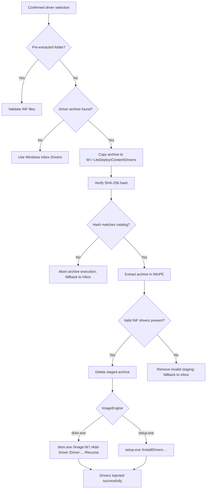

# Driver Selection, Extraction and Servicing

Updated 2026-10-08. **Runtime detection, archive copy, SHA-256 integrity verification, in-WinPE extraction, offline driver servicing via DISM, and Setup integration are fully implemented.**

## Runtime Detection

`WorkflowSelection` reads `Drivers.AutoDetectDrivers`, `AllowManualSelection`, and `AutoOnlineDownloadOnMedia` (defaults true in the UI). Automatic detection queries the hardware inventory for:
- Manufacturer (raw and normalized)
- Model
- SKU / System SKU
- System Architecture

Catalog: `<DeploymentRoot>\Content\Drivers\LocalCatalog.json`, containing `Manufacturers` nodes and `DrivePacks` collections.

### Candidate Matching Priority:
1. **Custom driver packs:** Manufacturer + Model + SKU.
2. **Custom driver packs:** Manufacturer + SKU.
3. **Custom driver packs:** Manufacturer + Model (when pack declares no SKU).
4. **OEM driver packs:** Matching manufacturer + SKU, then Model for packs without SKU declarations.
5. **Fallback:** If no candidate matches, the deployment proceeds using Windows inbox drivers.

## Content Resolution and Staging

Every driver pack candidate defines its `ContentLocation` and `ContentExtracted` flag.

### UI Candidate Discovery (Fast Non-Blocking Probing)
During Workflow Selection initialization, candidate discovery only validates file existence and non-zero file size metadata (`[System.IO.FileInfo].Length > 0`). This executes in **< 1 ms** over SMB, avoiding multi-gigabyte network reads and eliminating UI freezes.

### Staging & Extraction Mechanism

| Pack Format | Candidate Resolution | Staging & Extraction Mechanism |
| :--- | :--- | :--- |
| **Pre-Extracted Folders** | Validates folder existence and `.inf` content. | Directly accessible or copied to target volume `W:\~LiteDeploy\Content\Drivers\...` |
| **Dell CAB / Vendor EXEs** | Validates `.exe` / `.cab` exists and is non-empty (>0 bytes) over SMB. | Copied to `W:\~LiteDeploy\Content\Drivers\`, verified via local SHA-256 against catalog hash, extracted via `expand.exe` (CAB) or Dell silent extract `/s /e=<dest>` (same as OSDCloud/DAT). Quote `<dest>` only when the path has spaces. Extract to a local volume (`W:` / `X:`), not the share. |
| **Lenovo / HP Packages** | Validates archive file exists over SMB. | Copied to local staging, verified, and extracted using silent unattended switches (`/VERYSILENT /SUPPRESSMSGBOXES /DIR=... /EXTRACT=YES` for Lenovo, `/s /e /f ...` for HP). Verified for valid `.inf` driver trees. |

## Staging, Size Verification & Integrity Checks (Phase 3 Staging)

To ensure zero network delays during UI selection while maintaining strict reliability and security:
1. Candidate driver archives are copied from the network share to local high-speed staging storage (`W:\~LiteDeploy\Content\Drivers\`).
2. **Transfer Verification**: The exact byte length of the staged file (`(Get-Item $stagedArchive).Length`) is compared against the source file length (`(Get-Item $fullPath).Length`). If there is any size mismatch (e.g. from network drops), staging is aborted and safely falls back to in-box drivers.
3. **SHA-256 Integrity Check**: If declared in `LocalCatalog.json`, the file hash is calculated locally on the target disk using `Get-FileHash -Algorithm SHA256` and verified against the catalog hash.
4. **Extraction**: Once transfer and integrity are verified, extraction proceeds and the staged archive is cleaned up.
5. If any validation fails, deployment safely falls back to Windows in-box drivers.

## Driver Injection & Servicing

Depending on the configured `ImageEngine`:
- **DISM Engine (`dism.exe`)**:
  - Injects all extracted drivers offline into the newly applied OS volume:
    ```cmd
    dism.exe /Image:W:\ /Add-Driver /Driver:"W:\~LiteDeploy\Content\Drivers\<ModelPath>" /Recurse
    ```
- **Setup Engine (`setup.exe`)**:
  - Supplies the driver folder to Windows Setup via `/InstallDrivers "<DriverPath>"`.



## References

- [Dell CLI Options](https://www.dell.com/support/manuals/en-ca/dell-update-packages-v17.10.00/dup_17.10_users_guide/Windows-CLI-Options?guid=guid-7e40f460-fdff-4cf9-b26f-e58065d8acbe&lang=en-us)
- [Lenovo Deployment Guide](https://download.lenovo.com/mobilesjp/deployment_lenovo_software.pdf)
- [HP SoftPaq Deployment](https://h10032.www1.hp.com/ctg/Manual/c02787666.pdf)
- [DISM Driver Servicing Options](https://learn.microsoft.com/en-us/windows-hardware/manufacture/desktop/dism-driver-servicing-command-line-options-s14?view=windows-11)
