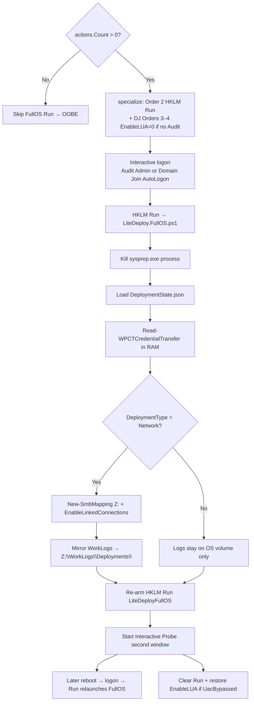

# Credentials

LiteDeploy keeps credential *integration* documentation here. Runtime transfer tooling lives in repo `Engine\Tools\` and is published by Admin.Build to the live share (`C:\DeploymentShare\Engine\Tools\`, etc.).

| Role | Location | What it does |
| --- | --- | --- |
| Server vault | [DeployVault](https://github.com/cmartinezone/DeployVault) | Encrypted credential store on the share (`Vault\`). **Future tool only** — not wired yet; see [IDEAS §12](../../planning/IDEAS_FOR_IMPLEMENTATION.md#12-future-tool-integration-deployvault-credentialvault--not-incorporated-yet). Target: RAM → `$global:LiteDeploySecretMap` for domain/local account create and run-as-X (no plaintext unattend). |
| Cross-reboot transfer | [WinPECT](https://github.com/cmartinezone/WinPECT) at `Engine\Tools\WinPECT\` | WinPE → OS handoff → In-Memory secret decryption (`Read-WPCTCredentialTransfer`), zero plaintext or DPAPI `.xml` files written to disk. |

## Paths

| Artifact | Path |
| --- | --- |
| Transfer package | `<OsDrive>\~LiteDeploy\Content\Credentials\CredentialTransfer.bin` (in-memory decryption; zero disk exposure) |
| Fallback CLIXML | `<OsDrive>\~LiteDeploy\Content\Credentials\*.xml` (legacy/fallback DPAPI support if present) |
| Registry bootstrap | `HKLM\SOFTWARE\LiteDeploy\CredentialTransfer` (offline SOFTWARE hive in WinPE / HKLM in FullOS) |
| Staged tools | `<OsDrive>\~LiteDeploy\Engine\Tools\WinPECT\` |

## Engine\Tools\WinPECT (trimmed runtime)

| File | Role |
| --- | --- |
| `WinPECredentialTransfer.ps1` | Upstream crypto / offline hive engine (supports `Read-WPCTCredentialTransfer`) |
| `LiteDeploy.WinPECT.ps1` | LiteDeploy paths + `Export-` / `Import-LiteDeployWinPECTCredentials` |
| `LICENSE` / `SOURCE.md` | Attribution |

Upstream CLI wrappers, `docs\`, and `Tests\` are not published on the share.

## FullOS Entry and Share Connection

| Mode | Entry | Role |
| --- | --- | --- |
| **WINPE** | `-BootObject` | Image OS; stage Runtime/Tools; WinPECT export when secrets are in memory |
| **FULLOS (first)** | `HKLM\...\Run\LiteDeployFullOS` | Interactive logon after specialize staged the Run value (when workflow actions > 0) |
| **FULLOS (reboot)** | Same Run value | Mid-deploy reboot survival (FullOS may re-arm; clears on finish) |

Specialize stages Run with a short `cmd /c reg add … /t REG_EXPAND_SZ` Path (same pattern as computer description). Nested-quoted PowerShell inside `reg add /d` breaks Setup specialize parse — avoid it. There is **no** `auditUser` FullOS launch.

### What WinPECT transfers

In-memory `PSCredential` only:

- **`DeploymentShare`** from `BootObject.Credential` / `$global:LiteDeployCredential`
- Entries in `$global:LiteDeploySecretMap` (e.g. `DomainJoin` from DeployVault)

No plaintext in unattend, state JSON, or logs. Secrets reside in RAM only.

### FullOS sequence (state-driven)

Interactive model: **Session 1** (Standard = Audit + built-in Administrator; Domain Join = AutoLogon local `user` + temporary UAC bypass when needed) with `EnableLinkedConnections = 1` for Explorer-visible `Z:`. First arm of Run = unattend specialize; FullOS re-arms for mid-deploy reboots; stock Setup sysprep left intact; probe = independent second window; keep HKLM Run as primary resume.

See [EndToEndDeploymentGuide.md](EndToEndDeploymentGuide.md), [Tools README](../../../Engine/Tools/README.md), and [deployment diagrams](../../architecture/LITEDEPLOY_DEPLOYMENT_DIAGRAM.md).
