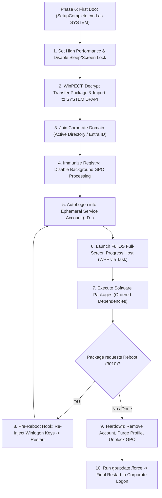
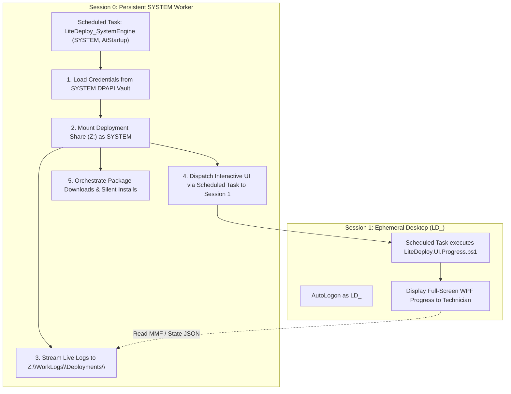
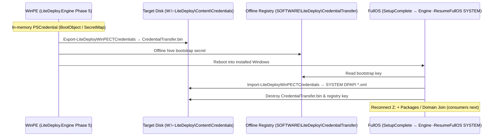
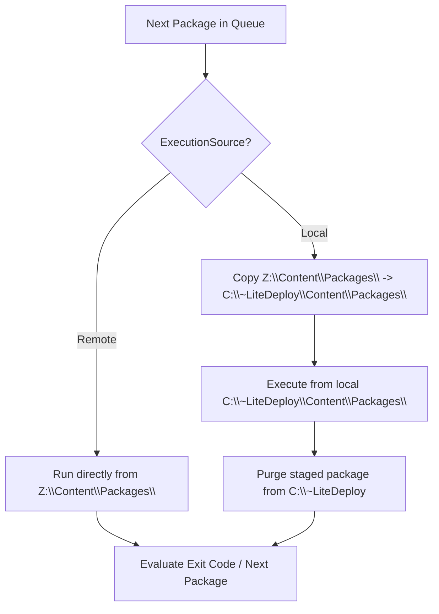
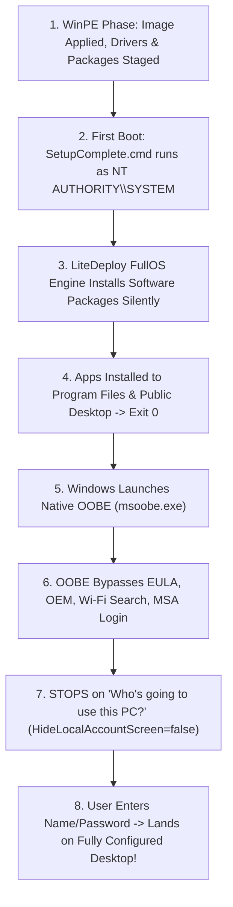
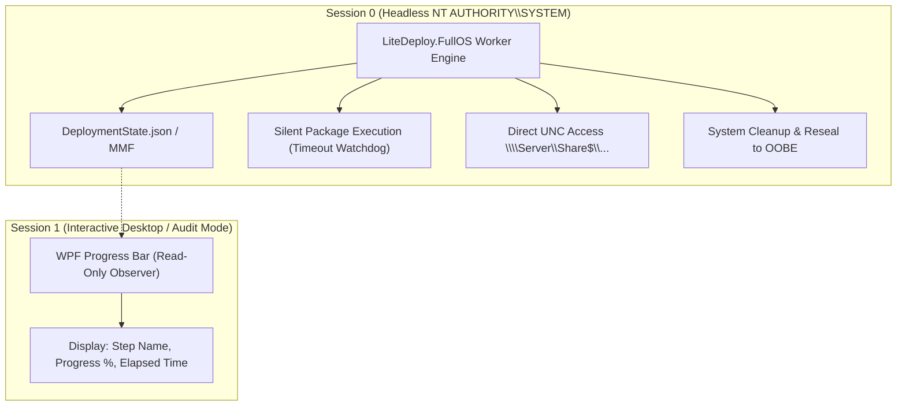

# Ideas and Proposed Designs for Implementation

This document tracks agreed-upon architectural ideas, designs, and feature enhancements for upcoming LiteDeploy phases.

> **Current implemented baseline (2026-10-17):** First FullOS launch is **HKLM Run** (`LiteDeployFullOS`), staged in unattend **specialize** when workflow actions > 0 (short `reg add` / `REG_EXPAND_SZ`; not `auditUser`). On direct execution, before resume, FullOS writes the HKCU console handoff so later consoles use Windows Terminal. FullOS may re-arm Run for mid-deploy reboots (scheduled tasks gated off), kills `sysprep.exe` while leaving stock Setup CmdLine intact, and starts Interactive Probe in a second window. Workflow Selection titles use `editionName` and append ` (version)` only when the name does not already contain it. Domain Join (non-Audit, actions > 0) may temporarily set `EnableLUA=0` in specialize and restore UAC on FullOS cleanup. Stock **MDT** resume is Startup `LiteTouch.lnk` / `RunOnce` / `FirstLogonCommands`→`LTIBootstrap` — not Task Scheduler. Sections below that still mention `SetupComplete.cmd` / Session 0 `LiteDeploy_SystemEngine` / Setup CmdLine resume / `auditUser` first entry are **future exploration or historical proposals**, not the live path.

---

## 1. Standard Workflow: FullOS Phase 6 Orchestration & GPO Immunization Plan

### Overview
The **Standard Workflow** enables deployment scenarios requiring domain membership, corporate security agents, application packaging, and interactive desktop execution without risk of Group Policy (GPO) or power timeouts interrupting AutoLogon.



### Key Technical Measures

#### A. Power Plan & Sleep Suppression
Immediately at first boot, enforce High Performance to prevent Windows from locking the screen during long silent installs:
```powershell
powercfg /setactive 8c5e7fda-e8bf-4a96-9a85-a6e23a8c635c
powercfg /change monitor-timeout-ac 0
powercfg /change standby-timeout-ac 0
powercfg /change hibernate-timeout-ac 0
```

#### B. GPO Immunization during Provisioning
Prevent background GPO refresh from restoring `Ctrl+Alt+Del`, legal notice banners, or screen savers while package installation is active:
```powershell
# Disable background GPO refresh during deployment
$gpoRegPath = "HKLM:\SOFTWARE\Policies\Microsoft\Windows\System"
if (-not (Test-Path $gpoRegPath)) { New-Item -Path $gpoRegPath -Force }
Set-ItemProperty -Path $gpoRegPath -Name "DisableGPO" -Value 1

# Disable CAD and Legal Notice prompts locally
Set-ItemProperty "HKLM:\SOFTWARE\Microsoft\Windows NT\CurrentVersion\Winlogon" -Name "DisableCAD" -Value 1
Set-ItemProperty "HKLM:\SOFTWARE\Microsoft\Windows\CurrentVersion\Policies\System" -Name "legalnoticecaption" -Value ""
Set-ItemProperty "HKLM:\SOFTWARE\Microsoft\Windows\CurrentVersion\Policies\System" -Name "legalnoticetext" -Value ""
Set-ItemProperty "HKLM:\SOFTWARE\Policies\Microsoft\Windows\Control Panel\Desktop" -Name "ScreenSaveActive" -Value "0"
```

#### C. Pre-Reboot Winlogon Hook
Before any package-triggered intermediate restart (Exit Code `3010`), LiteDeploy re-injects the AutoAdminLogon credentials to guarantee seamless resume:
```powershell
Set-ItemProperty "HKLM:\SOFTWARE\Microsoft\Windows NT\CurrentVersion\Winlogon" -Name "AutoAdminLogon" -Value "1"
Set-ItemProperty "HKLM:\SOFTWARE\Microsoft\Windows NT\CurrentVersion\Winlogon" -Name "AutoLogonCount" -Value 999
Set-ItemProperty "HKLM:\SOFTWARE\Microsoft\Windows NT\CurrentVersion\Winlogon" -Name "DefaultUserName" -Value $tempAdminUser
Set-ItemProperty "HKLM:\SOFTWARE\Microsoft\Windows NT\CurrentVersion\Winlogon" -Name "DefaultPassword" -Value $tempPassword
```

#### D. Teardown & Final Polish
Once all packages finish successfully:
1. Remove temporary service account (`Remove-LocalUser -Name $tempAdminUser`).
2. Purge user profile directory (`Get-CimInstance Win32_UserProfile | Where-Object { $_.LocalPath -like "*$tempAdminUser*" } | Remove-CimInstance`).
3. Clean up AutoLogon registry keys from `Winlogon`.
4. Remove `DisableGPO` registry block and trigger `gpupdate /force`.
5. Clean `C:\Windows\Panther` temporary installation artifacts.
6. Clean reboot to company branded login screen.

---

## 2. Persistent `SYSTEM` Worker Daemon & Interactive Task Dispatch

### Concept
`NT AUTHORITY\SYSTEM` acts as the persistent master engine (Session 0) across all FullOS phases and intermediate reboots. It maintains the authenticated SMB connection to the Deployment Share via DPAPI secrets, streams logs in real-time to the server, and dispatches interactive UI/processes into the ephemeral `LD_<UID>` user desktop (Session 1) using native Scheduled Tasks.



### Key Technical Implementation
1. **Persistent Startup Task (SYSTEM)**:
   ```powershell
   $action    = New-ScheduledTaskAction -Execute "powershell.exe" -Argument "-NoProfile -ExecutionPolicy Bypass -File 'C:\~LiteDeploy\Engine\Scripts\Runtime\LiteDeploy.FullOS.Engine.ps1'"
   $trigger   = New-ScheduledTaskTrigger -AtStartup
   $principal = New-ScheduledTaskPrincipal -UserId "NT AUTHORITY\SYSTEM" -LogonType ServiceAccount -RunLevel Highest
   Register-ScheduledTask -TaskName "LiteDeploy_SystemEngine" -Action $action -Trigger $trigger -Principal $principal -Force
   ```

2. **SYSTEM-to-User Interactive UI Dispatch (Session 1)**:
   ```powershell
   # SYSTEM launches the WPF Progress UI inside LD_<UID>'s active desktop session
   $uiAction    = New-ScheduledTaskAction -Execute "powershell.exe" -Argument "-ExecutionPolicy Bypass -File 'C:\~LiteDeploy\Engine\Scripts\Runtime\UI\LiteDeploy.UI.Progress.ps1'"
   $uiPrincipal = New-ScheduledTaskPrincipal -UserId "LD_$shortUid" -LogonType InteractiveToken -RunLevel Highest
   Register-ScheduledTask -TaskName "LiteDeploy_UI_Host" -Action $uiAction -Principal $uiPrincipal -Force
   Start-ScheduledTask -TaskName "LiteDeploy_UI_Host"
   ```

3. **Visible Network Drive Mapping (`Z:`) in `LD_<UID>` Explorer**:
   - When `LD_<UID>` logs in, a visible Network Drive (`Z:`) pointing to the Deployment Share (`\\Server\DeploymentShare$`) is mounted in Windows Explorer.
   - **Technician Visibility:** Technicians can open File Explorer / This PC and directly access `Z:\WorkLogs\Deployments\<UID>\LiteDeploy.Execution.log` using CMTrace or Notepad in real-time.
   - **Package Access:** Installers running in the user session can read `Z:\Content\Packages\...` seamlessly.
   - **Secure Teardown:** Cleanly unmapped via `Remove-SmbMapping -LocalPath "Z:" -Force` during final cleanup before account deletion.
   ```powershell
   # Mount visible share inside LD_<UID> session using DPAPI credentials
   New-SmbMapping -LocalPath "Z:" `
                  -RemotePath "\\Server\DeploymentShare$" `
                  -UserName $shareCred.UserName `
                  -Password $shareCred.GetNetworkCredential().Password `
                  -Persistent $true `
                  -SaveCredentials $false
   ```

---

## 3. Zero-Plaintext Credential Bridge via WinPECT & DPAPI

> **Implemented (core path):** see [Credentials](../integrations/Credentials/README.md). Remaining: DeployVault fetch into `$global:LiteDeploySecretMap`, domain-join / package consumers of CLIXML.

### Concept
Use [WinPECT](https://github.com/cmartinezone/WinPECT) (WinPECredentialTransfer) to bridge authenticated secrets (Domain Join credentials, Deployment Share credentials, LAPS seeds) across the WinPE ➔ FullOS reboot window with hardware-bound encryption and zero plaintext files.

### Workflow & Protocol


### Key Security Properties
- **Zero Plaintext at Rest:** No passwords in XML, INI, JSON, or task sequence logs.
- **Hardware Bound:** Payload bound to target device SMBIOS UUID / Serial Number.
- **Self-Destructing:** Temporary transfer package and registry decryption keys are deleted immediately upon DPAPI import.

---

## 4. Ephemeral Deployment Service Account (`LD_<UID>`)

### Concept
For standard workflows requiring interactive desktop sessions (FullOS Phase 6 for user-facing application installers, WPF desktop progress display, or GPU/per-user configuration), create a temporary, highly secure administrator account unique to each deployment.

### Key Specifications
- **Username Naming Convention:** `LD_<ShortUID>` (e.g. `LD_A8F29C`).
  - Constrained within the 20-character Windows SAM/NetBIOS limit.
  - Directly maps 1:1 to the deployment ID and server log folder (`Z:\WorkLogs\Deployments\<DeploymentUid>`).
  - 100% traceable in Windows Event Viewer (`Security Event ID 4624 / 4672`).
- **Dynamic Password Generation:**
  - Generated dynamically in WinPE from a GUID + random salt (e.g., `[guid]::NewGuid().ToString("N") + "!" + (Get-Random -Minimum 100 -Maximum 999)`).
  - Stored in `unattend.xml` under `<AutoLogon>` with `AutoLogonCount = 999` and decoded by Windows Setup.
  - Zero static or hardcoded passwords left on disks.

---

## 5. `SetupComplete.cmd` Orchestration Trigger

> **Implemented (entry):** staged from WinPE; calls `LiteDeploy.Engine.ps1 -ResumeFullOS` (same Engine, not a separate FullOS bootstrap). Remaining: power plan / GPO immunization / Packages from that entry.

### Concept
Instead of injecting complex post-install command scripts into `unattend.xml` (`<FirstLogonCommands>`), stage an offline `SetupComplete.cmd` directly in WinPE.

### Key Specifications
- **Target Path:** `W:\Windows\Setup\Scripts\SetupComplete.cmd`
- **Execution Context:** Native `NT AUTHORITY\SYSTEM` rights before user logon.
- **Responsibilities (current):**
  - Launch `LiteDeploy.Engine.ps1 -ResumeFullOS` (tee to `WorkLogs\SetupComplete.log`).
  - Engine: WinPECT import, Network Z: reconnect, log mirror, register `LiteDeploy_SystemEngine`.
- **Still planned from this entry:** High Performance power plan, GPO immunization, Packages orchestration.

---

## 6. Hybrid Package Execution Architecture (`Remote` vs `Local`)

> **Orchestrator plan (canonical):** [PACKAGE_ORCHESTRATOR_PLAN.md](PACKAGE_ORCHESTRATOR_PLAN.md) — resolve Specs into `DeploymentState.Packages.Queue`, FullOS loop, 3010 anti-loop, logging. Section below is the Remote/Local detail only.

### Concept
Allow each application package in `package.json` to define its execution locality (`ExecutionSource: "Remote" | "Local"`) to optimize network utilization, save disk space, and prevent failures caused by network-resetting installers.



### Execution Policies
1. **`ExecutionSource = "Remote"` (Network Direct / Default)**:
   - **Use Case:** Heavy application suites (Office 365, Adobe Creative Cloud, Autodesk, etc.).
   - **Benefit:** Zero local disk space wasted, skips unnecessary pre-copy latency. Installs directly over the authenticated SMB share connection.
2. **`ExecutionSource = "Local"` (Pre-Cached / Staged)**:
   - **Use Case:** Network/VPN clients (Cisco AnyConnect, GlobalProtect), network adapter drivers, or packages triggering immediate mid-install restarts.
   - **Benefit:** Complete isolation from temporary network interruptions; installer files remain available locally on `C:\~LiteDeploy\Content\Packages\<Id>`.
3. **Automated Disk Cleanup:**
   - Pre-cached local packages are purged immediately upon successful installation, and all remaining staging artifacts are scrubbed during final teardown.

---

## 7. Provisioning Packages (`.ppkg`) & Intune Autopilot Integration

### Concept
Support zero-touch enrollment into Microsoft Intune / Entra ID via Provisioning Packages (`.ppkg`) and offline Autopilot JSON profiles for both `dism.exe` and `setup.exe` imaging engines.

### Execution Mechanisms
1. **`dism.exe` Engine (Offline WinPE Injection - Recommended)**:
   - Injects the `.ppkg` directly into the offline volume during WinPE Phase 4:
     ```powershell
     dism.exe /Image:W:\ /Add-ProvisioningPackage /PackagePath:"W:\~LiteDeploy\Content\Provisioning\Enrollment.ppkg"
     ```
   - Stages offline Autopilot JSON profile to `W:\Windows\Provisioning\Autopilot\AutopilotConfigurationFile.json`.
   - **Benefit:** Pre-baked into Windows before first boot; ultra-fast startup.
2. **`setup.exe` Engine (`unattend.xml` Template Expansion)**:
   - Expands `<!--ProvisioningPackage-->` placeholder into `<component name="Microsoft-Windows-Provisioning-Core">` within `specialize` or `oobeSystem` passes.
   - Alternatively drops `.ppkg` into standard Windows drop folder (`W:\Recovery\Customizations\*.ppkg`).
3. **Unattended Configuration Baseline**:
   - `IntuneReady.xml` enforces `<ProtectYourPC>1</ProtectYourPC>`, `<HideWirelessSetupInOOBE>true</HideWirelessSetupInOOBE>`, and `<HideEULAPage>true</HideEULAPage>` to ensure zero user friction and direct landing on the corporate Intune enrollment screen.

---

## 8. Console & Terminal UX Modernization

### Key Specifications
- **In-Place Progress Indicators:**
  - Live in-place carriage-return (`\r`) driver injection counter (`[DRIVERS] Installing: 285/441 (65%) - Intel_I2C.inf`) to prevent terminal flooding.
- **Unicode Box-Art Headers:**
  - Modern framing for Phase banners matching active Dark/Light theme.
- **Pre-Reboot Summary Dashboard:**
  - Executive completion card detailing Model, Target Disk, Boot Mode, Image Applied, Driver Count, Total Duration, and Remote Log URI.
- **Interactive Restart Timer:**
  - 10-second countdown with keypress cancellation (`Press 'C' to cancel reboot`).

---

## 9. Standard & Workgroup Workflow: Pre-OOBE Silent Application Installation & Native User Handoff

### Overview
In the **Standard** (Standalone / Workgroup / Kiosk) workflow, application installations are orchestrated **silently at the system level before OOBE starts**, ensuring that when the end user completes the initial setup, their user account lands on a desktop that is 100% configured with all software ready to use.



### Key Technical Characteristics

1. **Pre-OOBE System Execution (Phase 6 / `SetupComplete.cmd`):**
   - Runs under `NT AUTHORITY\SYSTEM` before `msoobe.exe` initializes.
   - Screen displays the standard Windows *"Just a moment..."* / *"Getting ready..."* screen or custom LiteDeploy progress host.
   - Executes system-level installers (MSI, EXE, silent scripts) for standard tools (browsers, runtimes, utilities, corporate management agents).
   - Global shortcuts and associations are placed in `C:\Users\Public\Desktop` and `C:\ProgramData\Microsoft\Windows\Start Menu`.

2. **Offline AppX / MSIX Pre-Provisioning (Phase 5 in WinPE):**
   - Modern Windows Store apps are injected into the offline OS image using DISM:
     ```powershell
     dism.exe /Image:W:\ /Add-AppxProvisionedPackage /PackagePath:"..." /SkipLicense
     ```
   - Automatically provisions into the profile of any newly created local user in OOBE without requiring store downloads.

3. **Seamless Native OOBE Handoff (`Standard.xml`):**
   - Configured with:
     ```xml
     <OOBE>
       <HideEULAPage>true</HideEULAPage>
       <HideOEMRegistrationScreen>true</HideOEMRegistrationScreen>
       <HideWirelessSetupInOOBE>true</HideWirelessSetupInOOBE>
       <HideOnlineAccountScreens>true</HideOnlineAccountScreens>
       <HideLocalAccountScreen>false</HideLocalAccountScreen>
       <ProtectYourPC>1</ProtectYourPC>
     </OOBE>
     ```
   - All friction and Microsoft Account (MSA) login screens are bypassed, automatically landing the user on the local account creation screen (*"Who's going to use this PC?"*).

4. **Zero User Friction & Immediate Productivity:**
   - No post-logon installers, UAC prompts, or background installation reboots while the user is trying to work.
   - When the user sets their password and reaches their desktop, everything is operational.

---

## 3. Headless SYSTEM Execution with Decoupled Progress Bar (Production Architecture)

### Motivation & Comparison
During early development and lab staging, running LiteDeploy FullOS directly in the interactive user context (`Administrator` in Audit Mode) provides immediate visibility, live console diagnostics, and native access to mapped drives (`Z:`). 

For enterprise mass deployment, the target architecture separates the **Worker Engine** from the **User Presentation**:
- **Worker Engine (`NT AUTHORITY\SYSTEM` in Session 0):** Performs all package installations, driver configuration, and domain join tasks headless, with zero desktop dependencies and without requiring mapped drives (using direct UNC paths or local SSD caching).
- **Presentation Shell (`Interactive User` in Session 1):** A dedicated, locked WPF Progress Bar that acts purely as an observer. It reads execution state from `DeploymentState.json` or Memory-Mapped Files (MMF) and displays a clean, consumer-grade status screen without exposing consoles, desktop icons, or network drives.



### Key Technical Pillars for Future Exploration

1. **System Execution Parity Audit:**
   - Ensure all software installers and scripts execute cleanly under `NT AUTHORITY\SYSTEM`.
   - Implement process watchdog timers (e.g. 15-minute execution timeout per package) to kill and flag any hung processes that launch hidden non-silent UI prompts in Session 0.

2. **Headless Content Delivery:**
   - Avoid mapping network drive letters like `Z:` entirely.
   - Access deployment content directly via UNC paths using system/machine authentication, or pre-stage packages locally onto SSD (`C:\~LiteDeploy\Content\Packages`) before installation.

3. **Decoupled Inter-Process State Observation:**
   - The interactive UI in Session 1 does not execute deployment logic.
   - It polls `DeploymentState.json` (or receives signals via Memory-Mapped Files) to update the progress bar, step description, and error banners in real time.

4. **Complete In-System Teardown:**
   - Upon final step completion, the SYSTEM worker securely wipes local secrets, staging directories, and temporary tasks, then re-seals Windows to OOBE or locks the station.

---

## 11. Deep-Dive Research: Task Scheduler 'Queued' State vs RunOnce Dispatch

### The Problem
During post-boot execution in Windows Audit Mode, scheduled tasks registered with `New-ScheduledTaskTrigger -AtLogOn` (such as `LiteDeploy_ResumeEngine` and `LiteDeploy_InteractiveProbe`) can occasionally enter a **`Queued`** state in Task Scheduler (`schtasks /query`) rather than immediately launching (`Running`).

### Suspected Root Causes
1. **Logon Initialization Order & Session State:**
   - In Windows, the `AtLogOn` trigger fires when `winlogon.exe` creates the user session. However, the interactive user session must finish executing `userinit.exe`, shell registration, and `explorer.exe` before interactive tasks can establish a message pump.
   - If Task Scheduler detects that the desktop or session token is not yet ready for interactive window creation (`-LogonType Interactive`), it buffers the task in the `Queued` pool.

2. **MultipleInstancesPolicy & Task Instance Collisions:**
   - If a previous trigger or process check registered an instance, or if `MultipleInstances` is set to `Queue` (default for some task types), Task Scheduler waits until the first instance exits.
   - Setting `-MultipleInstances Parallel` or `-MultipleInstances IgnoreNew` should be tested to see if it eliminates queueing.

3. **Principal & Account Resolution:**
   - Registering with `-UserId 'Administrator'` can lead to domain/local ambiguity or waiting for full user profile hydration.
   - Testing `-UserId 'BUILTIN\Administrators'` or specific SID matching (`*-500`) vs omitting the user ID so the task binds strictly to whoever is currently interactively logging in.

4. **Resource & Battery Constraints:**
   - By default, Task Scheduler sets `DisallowStartIfOnBatteries = $true` and lower priority (`Priority = 7`). If the test VM or laptop simulates battery power, the task queues indefinitely.
   - LiteDeploy sets `-AllowStartIfOnBatteries` and `-Priority 4`, but we should test `Priority = 0` (Realtime/Highest).

### Comparative Alternative: MDT-style interactive hooks (not Task Scheduler)
Stock **MDT LiteTouch** does **not** program an `ONLOGON` / `ONSTART` scheduled task for resume. Observed model (`LiteTouch.wsf` `SetStartMDT` + unattend):
- **First Full OS entry:** AutoLogon + unattend `FirstLogonCommands` → `LTIBootstrap.vbs` → `LiteTouch.wsf`.
- **Mid-deploy reboot (Explorer present):** All Users **Startup** shortcut `LiteTouch.lnk` → `wscript.exe …\LiteTouch.wsf` (runs after shell load).
- **Mid-deploy reboot (no shell / Server Core / `HideShell`):** `HKLM\Software\Microsoft\Windows\CurrentVersion\RunOnce\LiteTouch`.

**Why (reliability, not speed):** Session 1 after desktop readiness; no Task Scheduler queue/battery/principal gates; easy cleanup (delete `.lnk` / consumed `RunOnce`).

**LiteDeploy live path:** `HKLM\...\Run\LiteDeployFullOS` (specialize-armed; FullOS may re-arm) — same interactive-logon family as MDT Startup/`Run`/`RunOnce`, intentionally avoiding AtLogOn tasks that hit `Queued` in Audit.

Historical “tomorrow’s experiments” (SetupComplete → RunOnce, Task Scheduler XML tweaks, latency bake-off) remain optional only if someone re-enables LiteDeploy_* tasks; not required while HKLM Run stays primary.

---

## 12. Future tool integration: DeployVault (CredentialVault) — not incorporated yet

> **Status:** Idea only. Do **not** vendor or wire DeployVault into Engine/Image/FullOS until explicitly scheduled. WinPECT remains the live transfer tool; DeployVault would be an optional **share-side vault tool** (same class as `Engine\Tools\WinPECT\`).

**Repo:** [cmartinezone/DeployVault](https://github.com/cmartinezone/DeployVault) (AES-256-CBC + HMAC vault + seed on the deployment share; PS 5.1 / WinPE).

**Why it fits LiteDeploy later**

- Avoids MDT/SCCM-style **plaintext passwords in unattend** / CustomSettings for domain join, service accounts, and package runners.
- Admin manages `Vault\localvault.bin` + `localseed.bin` on the share; WinPE only reads needed credential IDs into RAM → `$global:LiteDeploySecretMap` → existing WinPECT export.
- Trust boundary stays honest: anyone who can read vault+seed can decrypt all IDs in that vault; separate vault pairs per deployment group if needed.

**When it becomes useful (use cases)**

| Scenario | How DeployVault would help |
| :--- | :--- |
| Create / join with a **domain or local account** | `Get-VaultCredential -CredentialId DomainJoin` (or similar) in WinPE/FullOS — never write the password into `unattend.xml` |
| Run a **process / installer as account X** | Packages or FullOS actions pull `PSCredential` by ID and pass it to `Start-Process -Credential` / scheduled task / `Invoke-Command` without embedding secrets in workflow JSON |
| Share / API / service secrets | Same ID lookup into SecretMap for reconnect or app config, still no plaintext on disk |

**Suggested integration shape (future)**

1. Publish DeployVault scripts as `Engine\Tools\DeployVault\` (or keep vault binaries only under share `Vault\` and tools on demand).
2. Boot/Engine (WinPE): optional `Get-VaultCredential` for workflow-declared IDs → `$global:LiteDeploySecretMap`.
3. Existing path unchanged: SecretMap → WinPECT → FullOS in-memory unseal.
4. FullOS/Packages: resolve secrets by ID for account creation and “run as” actions.

**Out of scope until then:** no Admin.Build publish of DeployVault, no Image unattend coupling, no Hard dependency in FullOS.

---

## 13. Future analysis: JSON schema merge (JSONNormalizer) vs defensive property probing

> **Status:** Idea / analysis only. Do **not** implement or refactor Workflow/Image/catalog onto a normalizer until explicitly scheduled. Live State path stays `ConvertTo-LiteDeploySerializableObject` (depth 8) + `ConvertTo-Json -Depth 10`.

### Problem we already solve the hard way

LiteDeploy runs **`Set-StrictMode -Version 2.0`**. With `ConvertFrom-Json` (PS 5.1), missing JSON keys are **absent** properties — `$obj.Foo` throws. Catalog, workflow, BootConfig, and Image therefore use widespread **defensive / StrictMode-safe property probing**:

```powershell
if ($os.PSObject.Properties['arch']) { ... }
```

Rough scale (Engine Scripts sources; flat publish mirrors duplicate counts): **~250–300** unique `PSObject.Properties[` hits (Image ~90, Engine ~50, Workflow ~35, Drivers ~30, UI/others…). That is hydration boilerplate, not a named Microsoft API.

### Proposed idea (not coded)

A small **JSONNormalizer** helper (PS 5.1 / WinPE, no Newtonsoft):

- **Reference schema (master)** with defaults → `Merge-ReferenceObject` against incoming JSON  
- Preserve `$false` / `0` (do not treat as empty)  
- Array unwrap guard (`@($x)` / unary `,`)  
- UTF-8 **without BOM** read/write; explicit `ConvertTo-Json -Depth` (e.g. 20)  
- Optional `-Strict` to drop unknown keys  
- Deep copy so the schema master is not mutated  

### How it relates to current State code (different jobs)

| Concern | Live today | JSONNormalizer idea |
| :--- | :--- | :--- |
| DeploymentState → disk/MMF | `ConvertTo-LiteDeploySerializableObject` (**MaxDepth 8**) + `ConvertTo-Json -Depth 10` + UTF-8 no BOM write | **Do not replace** — strips secrets / non-JSON types |
| BootConfig / catalog / workflow JSON shape + defaults | Manual `PSObject.Properties[...]` everywhere | **Candidate** — merge once at load, then read `.Prop` safely |

### Analysis backlog (later)

1. **Semantics of empty string:** LiteDeploy often treats `""` as “omit” (JoinDomain, ProductKey, etc.). Merge-as-empty→default can reinject unwanted defaults — schema must use `$null`/sentinel for “omit”.
2. **Aliases:** `editionName`/`name`, `imageIndex`/`index` still need alias rules or keep probing.
3. **Arrays:** wrap-only vs per-item schema merge for catalog editions.
4. **Net line savings (estimate only):** first BootConfig/catalog/workflow adoption may be **~0–80 net** after ~180–220 lines of helper; broader Image/Workflow/UI adoption maybe **~+100–250 net** long-term. Early value is fewer StrictMode bugs / readability, not a huge delete.
5. **Pilot candidates if scheduled:** `BootConfig.json` load (Boot/Admin.Config), OS `catalog.json`, workflow JSON — **not** `DeploymentState.json`.
6. Compare with existing helpers like `Get-LiteDeployStateProperty` — avoid three parallel “safe get” styles.

**Out of scope until then:** no new Runtime module, no bulk delete of `PSObject.Properties[` checks, no change to State MaxDepth.

