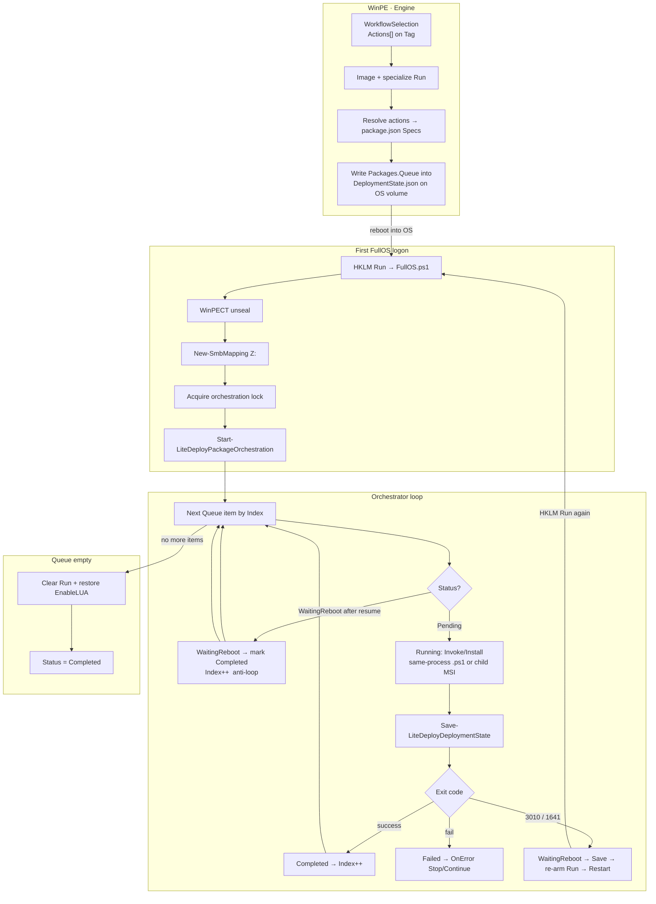
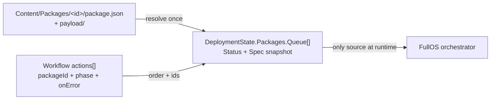
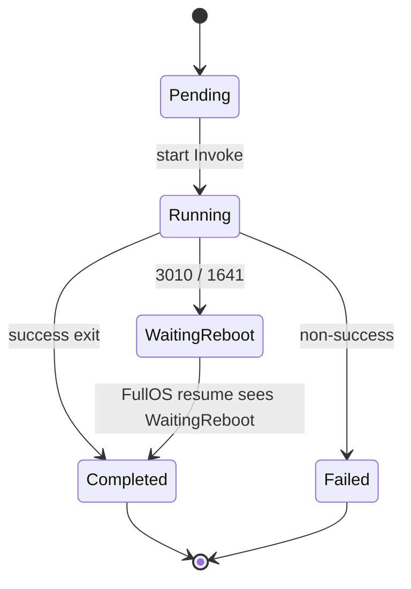

# Package Orchestrator Plan

**Status:** Plan only — not implemented.  
**Updated:** 2026-10-14  
**Depends on:** FullOS HKLM Run resume, WinPECT, `WorkflowTag.Actions`, existing `LiteDeploy.Packages.ps1` (Invoke/Install).  
**Related:** [IDEAS §6](IDEAS_FOR_IMPLEMENTATION.md) (Remote/Local), [Catalog/Workflow Spec](../architecture/LITEDEPLOY_CATALOG_WORKFLOW_SPEC.md), [LOCAL_TODO](../LOCAL_TODO.md).

---

## 1. Goal

After FullOS is interactive (Z: connected, secrets in RAM), run workflow **actions** as an ordered package queue. **Catalog/share defines packages; `DeploymentState` is the single execution source** (resolved Spec snapshot). Survive mid-queue reboots via existing **HKLM Run** re-arm — no Task Scheduler.

**Supported runners (via `LiteDeploy.Packages.ps1`):** `.ps1`, `.cmd`, `.bat`, `.exe`, `.msi`, plus free-form `command`. **No `.vbs`.** MSIX is out of scope for v1 (future).

---

## 2. End-to-end diagram

---

## 3. Authorship vs execution

| Layer | Role |
| :--- | :--- |
| `package.json` | How to run (command, args, ExecutionSource, exit codes) |
| Workflow `actions[]` | What / order / phase |
| `DeploymentState.Packages` | Checkpoint for **this** machine (do not re-read catalog after resolve) |

---

## 4. State shape (checkpoint)

Per queue item:

| Field | Values / notes |
| :--- | :--- |
| `ActionId`, `PackageId`, `Phase` | From workflow |
| `Status` | `Pending` → `Running` → `Completed` \| `Failed` \| `WaitingReboot` |
| `Spec` | Resolved snapshot from `package.json` |
| `ExitCode`, `Attempts`, timestamps | After each Invoke |
| `Packages.Index` | Current position |
| `Packages.ResumeCount` | Bumped on FullOS resume |

**Save** after every status change and **always before** `Restart-Computer`.

---

## 5. Reboot contract (anti-loop)

Rules:

1. Package reports reboot via **exit code** (`rebootExitCodes` in Spec); does **not** call `Restart-Computer` (orchestrator owns reboot).
2. On `WaitingReboot`: save state → re-arm HKLM Run → restart.
3. On next FullOS entry: if current item is `WaitingReboot`, set `Completed`, `Index++`, continue — **do not re-run** the same package.
4. Cap `Attempts` / max one reboot per action to break pathological 3010 loops.
5. Re-entrancy: orchestration lock file or state flag so Probe/second FullOS does not start a second loop.

---

## 6. Logging from package scripts

| Package kind | Pattern |
| :--- | :--- |
| First-party `.ps1` | Prefer **same-process** `& script` after Logs already loaded → `Write-LiteDeployLog -Component Pkg.<id>` |
| MSI/EXE vendor | Child process; orchestrator logs start/end/exit; stdout capture only |
| Fallback | Env `LITEDEPLOY_RUNTIME_ROOT` + dot-source Logs in child |

---

## 7. Implementation phases (todo breakdown)

### Phase A — Resolve + state (WinPE / handoff)

- [ ] Ensure workflow `actions` land on Tag / SelectionData (already partially true).
- [ ] At handoff (or end of Image): resolve each FullOS action → load `package.json` → write `Packages.Queue` + `Index=0` into OS-volume `DeploymentState.json`.
- [ ] Fail deploy early if `packageId` missing / invalid manifest.

### Phase B — Orchestrator (FullOS)

- [ ] `Start-LiteDeployPackageOrchestration` (FullOS or thin helper; reuse `Invoke-`/`Install-LiteDeployPackage`).
- [ ] Implement status machine + Index + WaitingReboot anti-loop.
- [ ] ExecutionSource Remote vs Local (stage under `C:\~LiteDeploy\Content\Packages\<id>`).
- [ ] Orchestration lock; Clear Run + UAC restore when queue finishes or Stop-on-error.
- [ ] Wire call after Z:/WinPECT in `LiteDeploy.FullOS.ps1` (replace “packages pending” log).

### Phase C — Hardening

- [ ] Max reboot/attempts per action; orphan `Running` recovery on resume.
- [ ] Same-process path for LiteDeploy `.ps1` packages + Logs.
- [ ] Progress UI reads `Packages.Queue` (replace Interactive Probe when ready).
- [ ] Lab: one package no-reboot; one package 3010 mid-queue; fail Stop; Local vs Remote.

### Out of scope v1

- SCCM-style detection methods / multi Deployment Types / dependency graph.
- DeployVault wiring (future tool).
- SYSTEM Session 0 package host.
- **Winget / Chocolatey package IDs** — internet/bootstrap/version-pin complexity; keep v1 share-local payloads only. Optional later via a separate `packageType` adapter, not in the core queue.

---

## 8. Success criteria

1. Standard workflow with 2+ actions completes without re-reading catalog after handoff.  
2. Mid-queue 3010 resumes at **next** package, not the same one.  
3. Failed Stop clears HKLM Run (no eternal FullOS logon loop).  
4. State mirrored to `WorkLogs\Deployments\<UID>` when Network.  
5. No Task Scheduler required.
